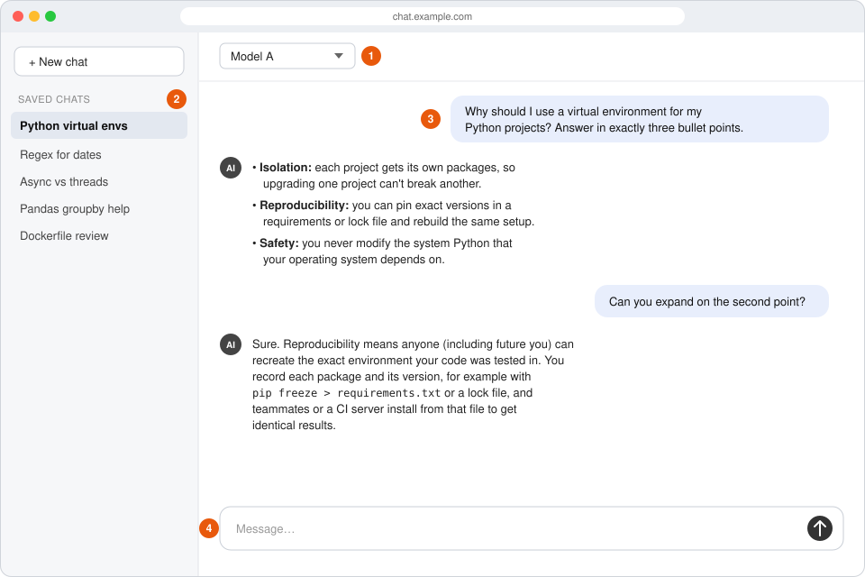
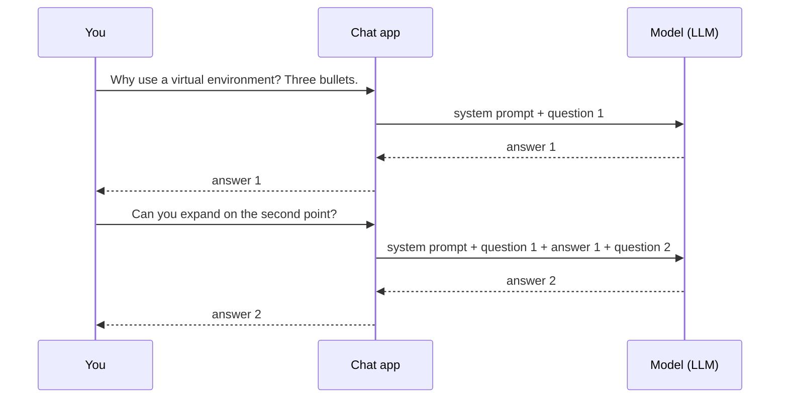
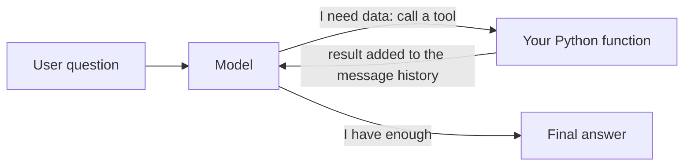

# From chat window to agent

*An orientation for Python developers who have used a chat assistant like
ChatGPT, Claude or Gemini, but have never built an agent. The code
examples use Pydantic AI.*

Welcome! This is the first lesson in the series, and it's a gentle one.
There's nothing to install and no code to run. You read, you look at a few
pictures, and you meet some ideas you already half know. It takes about 15
to 20 minutes.

Here's the thing: you know more about agentic programming than you think.
Every time you use a chat assistant, you are working with the same
building blocks a developer uses to build an agent. There's a **model**,
some **instructions**, a list of **messages**, and often **tools**. The
chat app hides them behind a friendly window. In this lesson we take that
window apart, one piece at a time, and then look at the same conversation
written as a short Python program.

You won't learn everything about agents here.  You don't need to. The
goal is to provide you with a mental model: a simple picture of how the pieces fit, which you
can hang every later lesson on.

**Keep a chat app open while you read**, if you have one handy: Claude,
ChatGPT, Gemini, whichever you like. Nothing here depends on it, but
whenever the lesson describes something you've done in a chat, you can try
it there and watch it happen.

## What you'll be able to do

By the end of this lesson, you'll be able to:

1. **Spot the parts of an agent in a chat you already use**: the model,
   your prompts and the app's instructions, the messages and who each one
   is from (you, the assistant, or the app itself), the history they add
   up to, tools, and the loop that runs them.
2. **Explain how a chat "remembers" what you said earlier**: who sends
   the earlier messages, and what your own code will have to do when you
   build an agent.
3. **Read a short Pydantic AI program and match it, line by line, to the
   chat**: where it picks the model, where it gives the instructions,
   where it sends the history, and what a tool looks like.

## Taking a chat apart

Let's start somewhere familiar: a chat window.



*① Model selector · ② Saved conversations · ③ The current conversation ·
④ Where you type your message*

This is a drawing, not a screenshot. It isn't Claude, ChatGPT or Gemini,
but a made-up app with the parts they all share. Real apps put those parts
in different places and change their look often, so a drawing
stays true longer than any screenshot would.

Find the four numbers, because the rest of the lesson keeps pointing back
at them:

- **① The model selector**, where you choose which model answers. Your app
  may tuck it into a menu, or not show it at all.
- **② Saved conversations**, the list of past chats in the sidebar.
- **③ The current conversation**: your messages and the replies.
- **④ The message box**, where you type.

The conversation in the drawing is the one this lesson follows all the
way through. Someone asks why they should use a virtual environment for
their Python projects, in exactly three bullet points, then asks a
follow-up about the second point. Keep it in mind; you'll see it again as
data, and then as code.

The window is the part you see. Behind it, every time you press send, the
app gathers some instructions and the conversation so far, sends them to a
model, and shows you what comes back. An agent is the same arrangement,
built by you: **a model, plus instructions, plus the message history, plus
tools, running in a loop.**

That sentence probably doesn't mean much yet, and that's fine. The rest
of this lesson unpacks it, one piece at a time.

**Key ideas** 
An "agent" has a handful of moving parts, and you have
used every one of them without knowing their names. We'll take them in
the order you'd meet them in a chat:

1. **The model**: Is the AI 'brain' and the part that writes the replies.
2. **Prompts and instructions**: what you ask, and how you want it
   answered.
3. **Messages and the history**: the conversation, as the app sees it.
4. **The model remembers nothing**: the surprise the whole series is
   built on.
5. **The conversation as data**: what a chat looks like under the hood.
6. **The same conversation in Pydantic AI**: your first look at the code.
7. **The agent**: the program we write to send and receive messages to
   and from the model.
8. **Tools and the loop**: how a model gets things done, and not only
   talks about them.

Each piece is short, and each one leans on the one before, so take them
in order. Each starts with something you have done a hundred times, and
ends with the thing you will write in code.

### 1. The model

Let's begin at the top of the window, with a part you have probably
played with already.

At the top of the window sits the model selector (①). The **model** is the
large language model (LLM) that writes the replies: the part of the
assistant that does the thinking.

Switch it, and the replies change. The rest of the app stays exactly as it
was: the same window, the same saved chats, the same conversation. That is
the first thing to notice. **The model is a swappable component.** You can
keep the task the same and change only the model, and in code that is a
one-line change.

If your app has no selector, it still uses a model. The app has picked one
for you.

### 2. Prompts and instructions

You have a model. Now it needs something to do, and this is the part of
the window you know best.

What you type in the box (④) and send is a **prompt**: a question, or a
task.

```text
Why should I use a virtual environment for my Python projects?
```

You can also tell the model *how* to answer, not only *what* to answer.
That is an **instruction**:

```text
Why should I use a virtual environment for my Python projects? Answer in exactly three bullet points.
```

Same question, very different answer: three tidy bullets instead of a few
paragraphs. Instructions shape an answer more than most people expect.
They are not guarantees, though. Ask for three bullets and now and then
you will get four. That is the model, not you, and building agents means
planning for it.

The instruction above applies to one message. Apps also attach
**standing instructions** to every message, without you typing them. They
have a name of their own, the **system prompt**, and you will meet them in
"4. The model remembers nothing" below. For now, notice the difference: some
instructions you type, and some are already there.

### 3. Messages and the history

One question on its own is fine. Real conversations go back and forth,
though, and that's where things start to get interesting.

Now ask a follow-up in the same chat:

```text
Can you expand on the second point?
```

The reply is about the second bullet, *Reproducibility* in the
illustration. You never said which point you meant. The assistant knew
anyway, from the conversation above it.

That conversation (③) is made of **messages**. Each one has a **role**,
which says who it is from:

- What you typed is a **user** message. Some frameworks call it a "human"
  message.
- Each reply is an **assistant** message. Some call it an "AI" message.

In order, the messages are the **message history**. It is the context
that made "the second point" mean something.

One question and its answer is a **turn**. The illustration shows two
turns: the three-bullet question and its reply, then the follow-up and
its reply. Hold on to that word; it comes back when tools arrive.

### 4. The model remembers nothing

So far, nothing here should have surprised you. This next piece usually
does. It's also the most important idea in the lesson, and the rest of
the series is built on it, so take this one slowly.

**The model itself remembers nothing.** It is *stateless*: every request
starts from a blank page. Before you read on, take a guess: how did the
follow-up work, then?

When you sent "Can you expand on the second point?", the app did not send
that sentence alone. It sent **the whole conversation**: the system
prompt, your first question, the model's answer, and then your new
question. The model "remembers" only because the app sends the history
again, every time.



Look at the second arrow into the model. It carries everything.

If that feels a little strange, you're in good company. Most people
assume the model keeps track of the chat, the way a person would. It
doesn't. The app does all the remembering.

The diagram has one message you never see: the **system prompt**. Before
your first message, the app adds standing instructions of its own,
something like "You are a helpful assistant. Be concise. Use Markdown
formatting." You never type it, and it shapes every answer. You can read
real ones: Anthropic
[publishes the system prompts](https://platform.claude.com/docs/en/release-notes/system-prompts/overview)
its Claude apps start every conversation with.

Everything sent to the model on one request is its **context**. The
context has a size limit, the **context window**. That is why a very long
chat eventually gets trimmed or summarized, or stops with a message
saying it is too long: the history no longer fits.

Two things in your chat app work the same way:

- **Saved chats** (②) are stored message histories. Reopen one, and the
  app loads the history back and carries on sending it. Nothing was kept
  inside the model.
- **"Memory" features**, which some apps offer, add facts from earlier
  chats to the context. The model still remembers nothing. The app sent
  it more.

Some model APIs can keep the history on their side for you. Pydantic AI
sends it each time unless you ask otherwise. In a chat app, all of this is
done for you. **When you build an agent, your code does it.**

### 5. The conversation as data

You've seen the conversation the way the app shows it to you. Time for a
peek underneath. There's no code to write here, only a short list to
read.

Underneath the window, a conversation is a list of messages. Here is the
one from the illustration, written in the form many model APIs take,
OpenAI's among them:

```python
messages = [
    {"role": "system",    "content": "You are a helpful assistant for Python developers. Be concise."},
    {"role": "user",      "content": "Why should I use a virtual environment for my Python projects? "
                                     "Answer in exactly three bullet points."},
    {"role": "assistant", "content": "• Isolation: ...\n• Reproducibility: ...\n• Safety: ..."},
    {"role": "user",      "content": "Can you expand on the second point?"},
    {"role": "assistant", "content": "Sure. Reproducibility means anyone (including future you) ..."},
]
```

Every piece of the window is here. The first entry is the system prompt
you never saw, with the role `system`. Then the two turns: a `user`
message and an `assistant` message each.

Look at the last `user` message on its own: "Can you expand on the second
point?" It means nothing by itself. With the list in front of it, it is
clear. That is the follow-up from the illustration, as data.

Not every API takes exactly this shape. Some keep the system prompt apart
from the list. The idea is the list, not the field names.

### 6. The same conversation in Pydantic AI

Here's the moment the chat app turns into code. Everything you have met
so far comes back, under new names, so this should feel like recognizing
old friends.

Pydantic AI gives you typed objects instead of raw dictionaries, and makes
the calls to the model for you. Here is the same session as a program.
Read it; you run nothing until the next lesson sets up Python.

```python
from pydantic_ai import Agent

agent = Agent(
    "openai:gpt-6.1-sol",  # 1. choose a model
    instructions="You are a helpful assistant for Python developers. Be concise.",
)

# Turn 1: send a prompt (with a per-message instruction)
result1 = agent.run_sync(
    "Why should I use a virtual environment for my Python projects? "
    "Answer in exactly three bullet points."
)
print(result1.output)

# Turn 2: continue the conversation by passing the history back in
result2 = agent.run_sync(
    "Can you expand on the second point?",
    message_history=result1.all_messages(),
)
print(result2.output)

# Look at the full message history
for message in result2.all_messages():
    print(message)
```

Match it to the window:

- **`Agent(...)`** is the thing you build. It bundles a model with its
  standing instructions (and, soon, tools). In the chat app, it is the
  assistant you talk to.
- **`"openai:gpt-6.1-sol"`** is the model selector. The string names a
  provider and one of its models; swapping it is the one-line change from
  piece 1. Model names change often, so check the provider's own list
  for current ones.
- **`instructions=`** is the system prompt. In a chat app the vendor
  writes it. Here, you do.
- **Each `run_sync(...)` is one turn**: one prompt in, one answer out.
  Pydantic AI calls it a **run**.
- **`message_history=result1.all_messages()`** is the big idea from
  piece 4, done by you: on turn 2 the whole conversation goes back to
  the model, and that re-sent history is how the model "remembers".
  Leave it out, and the second run is a new chat with no history — the
  model has no idea what "the second point" refers to.

Each printed message is long: it also holds timestamps, token usage and
IDs. Trimmed to what matters here, the history it prints is below. (It was
run with a stand-in for the model that gives the illustration's answers; a
real model's words would differ, and the shape would not.)

```python
ModelRequest(
    parts=[
        UserPromptPart(content='Why should I use a virtual environment for my Python projects? Answer in exactly three bullet points.'),
    ],
    instructions='You are a helpful assistant for Python developers. Be concise.',
)
ModelResponse(
    parts=[
        TextPart(content='• Isolation: ...\n• Reproducibility: ...\n• Safety: ...'),
    ],
)
ModelRequest(
    parts=[
        UserPromptPart(content='Can you expand on the second point?'),
    ],
    instructions='You are a helpful assistant for Python developers. Be concise.',
)
ModelResponse(
    parts=[
        TextPart(content='Sure. Reproducibility means anyone (including future you) ...'),
    ],
)
```

It is the list from piece 5, in the same order, with
better names. A **`ModelRequest`** is what your code sends; a
**`ModelResponse`** is what the model sends back. The **parts** inside
them are the pieces: your prompt is a `UserPromptPart`, the reply a
`TextPart`.

One difference is worth a second look. The list wrote the system prompt
as a message with the role `system`. Pydantic AI keeps the instructions
*beside* each request instead, which is why every `ModelRequest` above
records them. They are not sent over and over: on each call, only the
agent's current instructions go to the model, once.

And because the history is plain data, you can do what the sidebar (②)
does. Turn it into JSON, store it in a file or a database, and load it
back later to carry on the conversation.

### 7. The agent

One piece left to name, and it's the one the others all live inside.

Think back over what the chat app did for you in this lesson. It held the
model you picked. It kept the instructions you never typed. It gathered
the whole message history and sent it along with every request. All of
that "chat" — everything except the model itself — is work the app does
around the model.

**The agent is that work, as a program you write.** In Pydantic AI, the
`Agent` object you met in section 6 wraps it all in one place: you hand
it the model and the instructions once, then each `run_sync` call does
what the chat app did behind its window — it assembles the request,
sends it to the model, and hands you back the answer along with the
history it built up on the way.

A model on its own can only answer one request at a time, from a blank
page. The agent is the part that turns it into a conversation. One thing
is still missing, though: so far it can only *talk*. The last piece is
what lets it act.

### 8. Tools and the loop

Here's the last piece, and it's where things start to get fun.

Everything your agent has done so far is chat: text in, text out. What
makes it **agentic** is that the model can get things *done*, not only
talk about them. It does that with tools.

You have seen one. Ask a chat app something it cannot know from its
training, such as the newest release of Python, and it may show
"Searching the web…" before it answers. That is a **tool**.

Here is the surprise: **the model does not search the web.** It cannot
run anything. What it can do is reply with a request instead of an
answer: "call the search tool, with these words". The app runs the
search, adds the result to the conversation, and sends everything back.
The model reads the result, and either asks for another tool or writes
its answer.

That going round is **the loop**:



1. The model reads the question and the list of tools it may use.
2. If it needs information or an action, it replies with a **tool call**
   instead of an answer: "call `get_server_python_version`".
3. Your code runs the function and adds the result to the message
   history.
4. The model reads the result, and either calls another tool or writes
   the final answer.

Now the two words fit together. A **turn** is one question and its final
answer. The **loop** is what can happen *inside* a turn: the model asks
for a tool, the result comes back, and round it goes until the model can
answer. A turn with no tools goes round once. A turn that searches, reads
the result, then searches again, sends three requests to the model before
you see a word. Each trip round the loop is one more request, and the
model starts from a blank page every time. That is why each trip carries
the whole history, tool calls and results included.

Tool calls and their results are more messages. Everything from the
earlier sections still holds; the history gets a few extra entries.

In Pydantic AI, a tool can be a function with a decorator. Added to the
agent from the program above:

```python
@agent.tool_plain
def get_server_python_version() -> str:
    """Return the Python version installed on the build server."""
    return "3.13.2"  # in a real app: query the server
```

The docstring matters: it is how the model learns what the tool is for,
and so when to ask for it.

Some tools, web search among them, can also be run by the model's
provider rather than by your code. Pydantic AI offers those as built-in
tools. The loop is the same; only who runs the tool changes.

**This is why we build agents.** In a chat app, the vendor decides which
tools exist. When you build an agent, *you* do. Your tools can query your
database, call your company's APIs, read your files, or move a robot arm.
The model decides *when* and *how* to use them; your code supplies what
they can do.

**And that's the whole map.** Eight pieces, and every one of them was
already in the chat window you use every day. You now know their names,
and what each looks like in code. Next, a quick look back at all eight
side by side.

## What you can now do

That's it! Here is everything from the lesson on one page: on the left, something
you already do in a chat app; on the right, what it's called when you
build an agent.

| In your chat app | When you build an agent |
|---|---|
| Picking a model from a menu | Choosing the agent's **model** |
| Typing "answer in three bullets" | Giving **instructions**, for one message or, as a **system prompt**, for every message |
| The conversation on screen | The **message history**: a list your code keeps |
| A follow-up that "remembers" | Your code **sending the history again** with every request |
| Saved chats in the sidebar | **Storing** the message history and loading it back |
| One question and its answer | A **turn** (Pydantic AI calls it a **run**) |
| "Searching the web…" | A **tool**: a function the model can ask your code to run |
| "Searching…", then an answer | **The loop**: a tool call, its result, and round again until the model can answer |

Put together, it's the sentence you met at the start, and now it should
mean something: **an agent is a model, plus instructions, plus the message
history, plus tools, running in a loop.** The chat app you use every day
is one of them.

## Going further

- **Two ways to give standing instructions.** Pydantic AI has
  `instructions=`, which this series uses, and `system_prompt=`. The
  difference is where they live. A system prompt becomes part of the
  first request in the message history, and travels with that history
  wherever it goes. Instructions are added fresh to each request as it
  goes out, from whatever the agent's instructions are at that moment. A
  later lesson in Chapter 1 shows when that difference matters.
- **The official pages.** Pydantic AI's own pages on
  [agents](https://pydantic.dev/docs/ai/core-concepts/agent/),
  [message history](https://pydantic.dev/docs/ai/core-concepts/message-history/)
  and [tools](https://pydantic.dev/docs/ai/tools-toolsets/tools/) go into
  each idea in depth. You won't need them to follow this series, but
  they're there when you're curious.

## Next

Time to leave the chat window behind. In the next lesson, you set up
Python, `uv` and Pydantic AI on your own machine, and run your first
agent. The lesson after that builds an agent like the one you read here,
and prints the messages of a real run, so you can see the history for
yourself.

You install nothing in this lesson.

---

*Tested with `pydantic-ai` 2.56.0 and `pydantic-ai-harness` 0.56.0.*
