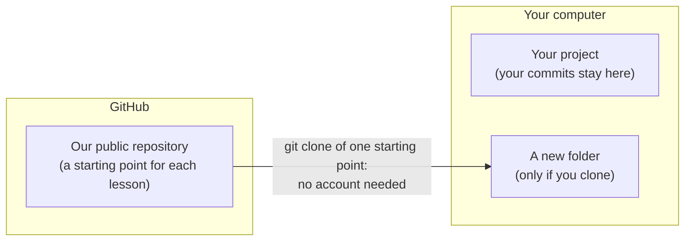

# The tools: uv, git, Ruff and mypy

*A short reading page, before the setup lesson. Nothing to install or
run yet.*

You've seen the parts of an agent. Before you build one, here's a quick
look at the workbench.

In the next lesson you set up the project this series builds on, and you
type commands for four tools along the way: **uv**, **git**, **Ruff** and
**mypy**. You may already use some of them every day. If so, skim this
page; it takes about five minutes either way. If one of them is new to
you, that's fine too. This page isn't a tutorial on any of them. Its job
is smaller: when a command shows up in a lesson, you already know what
the tool is and why it's there.

**You don't need to learn these tools to follow the series.** Every lesson
gives you each command in full, and says what it should print. Run them
as given. Each section below ends with a link to the tool's own
documentation, for whenever you're curious.

## What you'll be able to do

By the end of this page, you'll be able to:

1. **Say what each of the four tools is for, and what the series asks you
   to do with it.**

## The workbench

In the orientation, the chat app did a lot for you without saying so. One
thing it hid was the workshop behind it. Someone installed the software,
chose the versions, checked the code, and kept every saved conversation.
When you build an agent yourself, that work is yours, and these four
tools do most of it.

Each one answers a question you'd otherwise have to answer by hand:

| Tool | The question it answers | What the series asks of you |
|---|---|---|
| **uv** | Does this project have the Python and packages it needs, at the same versions on every machine? | Run the commands each lesson gives you |
| **git** | Can I get back to where I was? | Commit your work; clone a lesson's starting point if you need one |
| **Ruff** | Does this code follow one standard, and does it hold any likely mistakes? | Add it, configure it, and run it before each commit |
| **mypy** | Do the types in this code actually fit together? | Add it with Ruff, configure it, and run it before each commit |

We'll start with the one you'll use most.

### 1. uv

Every Python project needs the same few things. It needs the right
version of Python, its own set of installed packages kept apart from
every other project's, and a record of exactly which versions it uses, so
that it runs the same everywhere. For years that took several tools: one
to install Python, one to make an environment, one to install packages,
another to pin their versions.

**uv** does all of it, in one tool. If your machine doesn't have the
Python a project asks for, uv downloads it, so you don't install Python
yourself. It creates the project's
**virtual environment**, a folder of packages that belongs to this
project alone. It adds the packages you ask for, and writes a
**lockfile** that records the exact version of every one of them. And
when you run a command with `uv run`, it first brings the lockfile and
the environment up to date with the project, installing or updating
whatever has changed, and then runs it. You never manage the
environment by hand. It's made by Astral, the company behind Ruff, and
it's designed to be fast.

In this series you meet uv in almost every lesson, usually as `uv run`.
The setup lesson explains each command the first time you type it.

Further reading, at the time of writing: [uv's documentation](https://docs.astral.sh/uv/).

### 2. git

You almost certainly know git already, so this is a reminder, with one
point that matters for this series.

git keeps your project's history. Each **commit** records a snapshot of the
files git tracks at that moment, with a message saying what changed. That gives you
a way back to any point you saved. It's a little like the saved chats in
a chat app's sidebar: a history that's kept for you, so you can come back
to it later.

Here's the point that matters. **Your repository lives on your
computer.** A commit is saved there, and nowhere else. Nothing goes
online unless you **push** it to a remote repository, such as one on
GitHub, and no lesson in this series asks you to.

There's one remote you will meet. Our code for the series sits in a
public repository on GitHub, and it keeps a starting point for every
lesson. If you ever skip a lesson, or your project breaks, you can
**clone** the starting point you need: download a copy of the repository
into a new folder. Each lesson's clone command names its own starting point, so you
always get the right one.

Three things worth knowing about that clone:

- **You don't need a GitHub account.** Anyone can clone a public
  repository.
- **Cloning makes a new folder.** It never touches your own project.
- **Your copy can't change ours.** You can commit in it as much as you
  like; those commits stay on your machine unless you push them
  to your own 'remote' GitHub repository.

If you already have a GitHub account and push your own work there, that's
your choice. Nothing in the series depends on it either way. Each lesson
that needs a git command gives it to you in full.

Further reading, at the time of writing: [Pro Git, chapter 2](https://git-scm.com/book/en/v2/Git-Basics-Getting-a-Git-Repository),
the free book on git, covers commits and history;
[Working with Remotes](https://git-scm.com/book/en/v2/Git-Basics-Working-with-Remotes)
covers cloning and pushing.

### 3. Ruff

The next two tools read your code without running it. Ruff does two jobs.

As a **formatter**, it rewrites your code's layout to one consistent
style: spacing, line breaks, quotes. It never changes what the code does.
Nobody on a project argues about style, or fixes it by hand.

As a **linter**, it reads your code and reports likely mistakes, and
places where the code breaks a standard the project has chosen. Out of
the box it catches things like an import nobody uses. This series also
switches on stricter rules, so it reports a function with no type
annotations, or a name that breaks Python's conventions, too. Each report
is what this series calls a **finding** (Ruff's own docs say
"violation"). It names the file, the line and the rule.

Ruff does work that used to need several separate tools, and it's made
by the same company as uv.

The setup lesson asks you to do three things with it. You **add** it to
the project, **configure** it by pasting a few lines into
`pyproject.toml` (they choose which rules it applies), and **run** it,
first `uv run ruff format`, then `uv run ruff check`. (The `uv run` in
front is there because Ruff is installed inside the project, not on your
system.) From then on you run it before
every commit.

One habit carries through the whole series: **when Ruff reports a
finding, look into it, and fix the code unless there's a good reason not
to.** There is a way to switch a finding off with a comment, and on rare
occasions it's the right call. But never silence a finding only to get a
clean report: most of the time it's pointing at something real.

Further reading, at the time of writing: [Ruff's documentation](https://docs.astral.sh/ruff/).

### 4. mypy

Python lets you annotate your code with types: `name: str`, `-> int`.
Python itself doesn't normally check them when it runs your program.
**mypy** does, without running anything. It reads the annotations and
checks that every value is used consistently with its declared type: a string passed where a number is expected, or the
result of a function that returns nothing being used as if it returned
something.

This series runs mypy in its strict mode, so every function must be
annotated. That's the main reason the code you write in this series
carries type annotations everywhere.

You add mypy in the same command as Ruff, paste a few lines of its own
settings into `pyproject.toml`, and run it with Ruff before each commit,
as `uv run mypy .` (the dot means "this folder": the whole project).

A clean mypy run doesn't prove your program is correct. It means mypy
found no type problems under the checks you've switched on. That's
worth a lot, because it catches a whole class of mistakes before the code
ever runs, but it doesn't replace running and testing it.

Further reading, at the time of writing: [mypy's documentation](https://mypy.readthedocs.io/en/stable/).

**And that's the workbench.** Four tools, and you won't need to remember
how to drive any of them: the lessons give you every command. What you
take away is what each one is for, so none of them catches you off
guard.

## What you can now do

| When a lesson says… | You know it's… | And the series asks you to… |
|---|---|---|
| `uv run …` | uv bringing the project's lockfile and environment up to date, then running the command | run the commands each lesson gives you, as given |
| `git commit …` | git saving a snapshot of your tracked files, on your computer only | commit at the end of each lesson; never push, unless you choose to |
| `git clone …` | git downloading one lesson's starting point into a new folder, with no account needed | clone only if you skip a lesson or your project breaks |
| `uv run ruff format`, `uv run ruff check` | Ruff tidying your code's layout, then reporting likely mistakes | run both before every commit, and look into whatever they report |
| `uv run mypy .` | mypy checking that your types fit together, without running the code | run it with Ruff, before every commit |

## Next

Next, a signpost: pick the install page for your operating system —
macOS, Linux, or Windows via WSL. Then, in the setup lesson, you set up
the project for real: you install Pydantic AI with uv, run your first
agent with no API key, check your code with Ruff and mypy, and commit it
all with git.

You install nothing on this page.

---

*Tested with `pydantic-ai` 2.56.0 and `pydantic-ai-harness` 0.56.0.*
