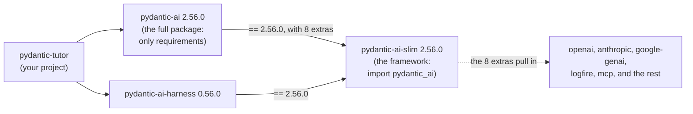
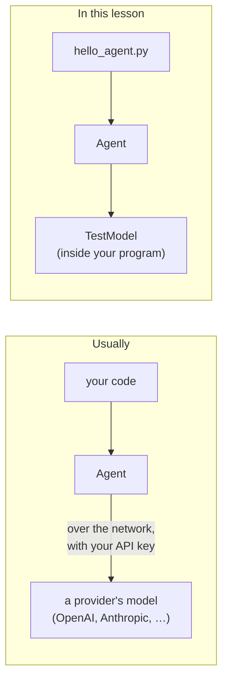

# Setting up the environment

Every lesson in this series adds to one project, and every lesson's code is
tested against exact versions of the library. Before you write any agent
code, you need that project: the right Python, the right Pydantic AI, and a
first agent run that tells you it all works, without an API key and without
spending a cent.

> Tested with `pydantic-ai` 2.56.0, `pydantic-ai-harness` 0.56.0, Python 3.14
> and `uv` 0.13.1. About 15 minutes, not counting installing tools.

## What you'll learn

By the end of this lesson you can:

1. **Install or upgrade `uv`**, and check which version you have.
2. **Create a `uv` project** pinned to `pydantic-ai` 2.56.0 and
   `pydantic-ai-harness` 0.56.0 on Python 3.14, and say why those two pins
   must move together.
3. **Run an agent with no API key**, and make sure your `.env` file cannot
   be committed by accident.

## What you'll build

You start from an empty folder and end with a Python project, in its own git
repository, with a first agent in it. Every file is made by a command you
run, except two you write yourself:

```text
pydantic-tutor/
├── .gitignore              made by uv; you add one line for .env
├── .python-version         made by uv: 3.14
├── README.md               made by uv, empty
├── hello_agent.py          you write it: a five-line agent that needs no API key
├── pyproject.toml          made by uv: the project, its dependencies and their pins
├── uv.lock                 made by uv: the exact version of every package installed
└── src/
    └── pydantic_tutor/
        └── __init__.py     made by uv: the package, with a hello-world command
```

## The road ahead

You get there in six steps, each building on the one before:

| Step | What you do |
|---|---|
| 0. Check your tools | Confirm `git` and `uv`, and that git knows your name |
| 1. Create the project | `uv init` an empty folder, and run its command |
| 2. Install Pydantic AI | Add the two pinned packages, and see what came with them |
| 3. Run your first agent | Five lines of Python on `TestModel`, with no API key |
| 4. Keep secrets out of git | Make sure `.env` cannot be committed by accident |
| 5. Commit | Save the project in git |

Each step ends with a **check**. If a check does not show what it says,
stop there: the next step builds on it.

## Step 0: Check your tools

> **Goal:** Confirm you have `git`, and `uv` 0.13.1 or newer, and that git knows your
> name and email.

Everything in this lesson runs in a terminal, on macOS or Linux, with two
tools: `git` and `uv`. You do not need to install Python.

**Do this**

Run:

```bash
git --version
uv --version
```

If either command is not found, or `uv` is older than 0.13.1, follow the
guide for your system, then come back:

- [macOS](install-macos.md)
- [Linux](install-linux.md)
- [Windows](install-windows.md): you work inside WSL, a Linux system on
  Windows

Then check that git knows who you are:

```bash
git config user.name
git config user.email
```

If either prints nothing, set it:

```bash
git config --global user.name "Your Name"
git config --global user.email "you@example.com"
```

> [!TIP]
> **Check:** The first two commands print versions, such as:
>
> ```text
> git version 2.50.1 (Apple Git-155)
> uv 0.13.1 (62faed335 2026-10-13 aarch64-apple-darwin)
> ```
>
> `uv` is 0.13.1 or newer, and the two `git config` commands each print a
> value.

**What it means**

**Term: `uv`.** A tool that manages a Python project for you: it downloads
Python, creates the project's virtual environment, installs packages, and
runs your commands inside that environment. That is why you do not install
Python yourself: `uv` downloads the version the project asks for.

**Why git needs your name and email.** `uv` copies them into the project's
`pyproject.toml` in step 1, and every commit records who made it. On some
systems a commit fails without them; on others git guesses, and the guess
ends up in your history.

## Step 1: Create the project

> **Goal:** Create a `uv` project for Python 3.14, and run the command it comes with.

You have the tools. Now you make the project that every lesson in the series
adds to.

**Do this**

Make an empty folder for the project, outside any other git repository, and
go into it. Every command from here on runs inside this folder.

Run:

```bash
mkdir pydantic-tutor
cd pydantic-tutor
uv init --package --python 3.14
```

You should see:

```text
Initialized project `pydantic-tutor`
```

List what is there now:

```bash
ls -A
```

```text
.git
.gitignore
.python-version
README.md
pyproject.toml
src
```

> [!TIP]
> **Check:** Run the command the project comes with:
>
> ```bash
> uv run pydantic-tutor
> ```
>
> You should see this. Your paths will differ, and so may Python's patch
> version (3.14.8 here); if `uv` already has a Python 3.14, the two download
> lines are missing:
>
> ```text
> Downloading cpython-3.14.8-macos-aarch64-none (download) (25.4MiB)
>  Downloaded cpython-3.14.8-macos-aarch64-none (download)
> Using CPython 3.14.8
> Creating virtual environment at: .venv
>    Building pydantic-tutor @ file:///Users/you/pydantic-tutor
>       Built pydantic-tutor @ file:///Users/you/pydantic-tutor
> Installed 1 package in 2ms
> Hello from pydantic-tutor!
> ```

**What it means**

**Term: project.** A folder with a `pyproject.toml`, the file that
describes it: its name, the Python it needs, and the packages it depends on.
`uv` filled in your name and email from your git settings.

**Term: package.** Code you can import. Yours is `pydantic_tutor`, in
`src/pydantic_tutor/`. The project is named after the folder,
`pydantic-tutor`; the package has the same name with an underscore, as
Python requires.

**Term: virtual environment.** An isolated set of installed packages for
this project, run with the Python `uv` chose for it, so that projects on the
same machine do not interfere. `uv` keeps it in `.venv`.

**Why `--package`.** It makes the project an installable package, with its
code under `src/`. That is already `uv`'s default at 0.13.1; we pass it
anyway, so the command says which layout you get.

**Why `--python 3.14`.** It writes `3.14` to `.python-version`, which `uv`
reads to choose the interpreter for this project, and
`requires-python = ">=3.14"` to `pyproject.toml`: the project runs on 3.14
here, and declares it needs 3.14 or newer anywhere.

**Notice: `uv run` did more than run.** Before running the command, it made
the environment match the project: it downloaded Python 3.14 (only the first
time), created `.venv`, and installed your package into it. Every `uv run`
checks this again, so the environment always has what `pyproject.toml`
asks for.
The command itself, `pydantic-tutor`, is a `main()` function in
`src/pydantic_tutor/__init__.py` that prints a greeting; `pyproject.toml`
turns it into a command.

**Watch out: start outside any other git repository.** Because the folder was
not a git repository yet, `uv init` also made it one (`.git`) and wrote a
`.gitignore`. Inside another repository it does neither, and steps 4 and 5
would not work as written.

## Step 2: Install Pydantic AI and the harness

> **Goal:** Add the two packages the series is built on, at pinned versions, and say why
> the two pins move together.

The project runs, but it has no Pydantic AI yet. You add it with one
command, at the versions this lesson was tested with.

**Do this**

Run:

```bash
uv add "pydantic-ai==2.56.0" "pydantic-ai-harness==0.56.0"
```

`uv` prints a short summary, then one line for every package it installed:
about a hundred, each starting with `+`, in alphabetical order. Your two,
`+ pydantic-ai==2.56.0` and `+ pydantic-ai-harness==0.56.0`, are somewhere
in the middle. You do not need to read the list: the check below shows what
matters.

Open `pyproject.toml`. Yours should look like this, with your own name and
email:

`pyproject.toml`:

```toml
[project]
name = "pydantic-tutor"
version = "0.1.0"
description = "Add your description here"
readme = "README.md"
authors = [
    { name = "Ada Student", email = "ada@example.com" }
]
requires-python = ">=3.14"
dependencies = [
    "pydantic-ai==2.56.0",
    "pydantic-ai-harness==0.56.0",
]

[project.scripts]
pydantic-tutor = "pydantic_tutor:main"

[build-system]
requires = ["uv_build>=0.13.1,<0.14.0"]
build-backend = "uv_build"
```

> [!TIP]
> **Check:** Ask `uv` what depends on `pydantic-ai-slim`:
>
> ```bash
> uv tree --invert --package pydantic-ai-slim --depth 1
> ```
>
> You should see this. Check that `pydantic-ai-slim` says `v2.56.0` and
> `pydantic-ai-harness` says `v0.56.0`:
>
> ```text
> Resolved 107 packages in 3ms
> pydantic-ai-slim v2.56.0
> ├── pydantic-ai[anthropic, cli, evals, google, logfire, mcp, openai, web] v2.56.0
> ├── pydantic-ai-harness v0.56.0
> └── pydantic-evals v2.56.0
> ```

**What it means**

**Term: dependency.** A package your project needs. `uv add` records it in
`pyproject.toml`, works out every package *it* needs in turn, and installs
the lot: about a hundred here, for the two you asked for.

**Term: pin.** `==2.56.0` allows exactly one version.

**Term: extra.** An optional part of a package, switched on by name in
square brackets, like `pydantic-ai-slim[openai]`. Each extra pulls in the
packages that part needs.

**What you installed.**

- **`pydantic-ai`** is the full package, and it holds none of the
  framework's code: apart from the `pai` command, it is a list of
  requirements. It requires
  `pydantic-ai-slim`, which *is* the framework (the `pydantic_ai` module you
  import comes from it), with eight of its extras switched on: the clients
  for the OpenAI, Anthropic and Google models, and the command-line
  interface, MCP, evals, web UI and Logfire integrations.
- **`pydantic-ai-harness`** is a separate package of more ready-made
  *capabilities* (a few also ship with the framework itself), pieces that
  plug into an agent to give it things like
  memory, or access to files and a shell. You meet them in later lessons.



**Notice: `pydantic-ai-slim` is in the tree although you never asked for
it.** It is where your code comes from.

**Watch out: you did not install the framework twice.** You installed it
once, by way of a package that only points to it.

**Why the two pins move together.** Both packages require
`pydantic-ai-slim` at exactly 2.56.0, so at these versions you cannot move
one without the other. So far each harness release has required its own
`pydantic-ai-slim` (0.57.0 requires 2.57.0), so an upgrade is usually of
both, to matching versions.

**Watch out: let `uv` write this file.** You did not edit
`pyproject.toml`; `uv init` and `uv add` wrote all of it. Add and remove
dependencies with `uv`, so the file always matches what is installed.

## Step 3: Run your first agent

> **Goal:** Run an agent with no API key, and read what Pydantic AI's banner tells you.

Everything is installed. Five lines of Python prove it works.

**Do this**

Create a file called `hello_agent.py` in the project folder, next to
`pyproject.toml`, with this content:

`hello_agent.py`:

```python
from pydantic_ai import Agent
from pydantic_ai.models.test import TestModel

agent = Agent(TestModel())
result = agent.run_sync("Hello!")
print(result.output)
```

> [!TIP]
> **Check:** Run it:
>
> ```bash
> uv run hello_agent.py
> ```
>
> You should see this. The banner's layout depends on how wide your terminal
> is: in a narrower one, its lines wrap differently, and below about 60
> columns the drawing is left out. Check the first line's versions and the
> last line:
>
> ```text
>                  pydantic-ai v2.56.0 • pydantic-ai-harness v0.56.0 • Python 3.14.8
>       / \
>      /   \       agent: agent • model: test:test • tools: 0 • capabilities: 0
>    /___.___\
>   /    |    \    observability: off — see every model and tool call live, with cost
> /      |      \    set it up free with Logfire and a GitHub login: https://pydantic.dev/ai-setup.md
> `---.._|_..---'    or use any OpenTelemetry backend: https://pydantic.dev/docs/ai/logfire/#otel
>
>                  goes away once observability is on — or PYDANTIC_AI_NO_BANNER=1
> success (no tool calls)
> ```

**What it means**

**Term: agent.** An `Agent` sends your prompt to a model and gives you back
its answer. `run_sync` runs it and waits for the result; `result.output` is
the answer. The next lesson explains agents properly; here, it is a check
that the install works.

**Term: model.** What answers the prompt. Usually that is a large language
model run by a *provider*, such as OpenAI or Anthropic, which you reach over
the network with an *API key* that the provider bills you for.

**Term: `TestModel`.** A stand-in model that ships with Pydantic AI. It
answers at once, inside your own program, without calling any provider, so
it needs no API key and costs nothing. Unless you tell it what to say, it
replies `success (no tool calls)` when no tool was called: the last line of
the output.



**Term: banner.** Everything above the last line. Pydantic AI prints it once
per process, the first time an agent runs. It confirms the versions you
installed, the agent's name (taken from the variable you assigned it to,
`agent`) and the model it used, and suggests setting up *observability*: a
way to see every request the agent makes, which a later lesson covers.

**Notice: you can turn the banner off.** Set `PYDANTIC_AI_NO_BANNER`:

```bash
PYDANTIC_AI_NO_BANNER=1 uv run hello_agent.py
```

```text
success (no tool calls)
```

**Keep `hello_agent.py`.** Whenever your environment looks wrong, running it
again tells you in a second whether Pydantic AI still works.

## Step 4: Keep secrets out of git

> **Goal:** Make sure a `.env` file cannot be committed by accident, before it exists.

From the chat lesson on, your project holds a secret: your API key, in a file
called `.env`. You do not create that file yet; you make sure git never
picks it up by accident.

**Do this**

Ask git whether it would ignore a `.env` file now:

```bash
git check-ignore -v .env
```

It prints nothing: nothing in `.gitignore` covers `.env` yet.

Open `.gitignore` and add these lines at the end, starting with the blank
line:

`.gitignore` (add at the end):

```gitignore

# Secrets: holds your API key from the chat lesson on. Never commit it.
.env
```

The whole file should now read:

```gitignore
# Python-generated files
__pycache__/
*.py[oc]
build/
dist/
wheels/
*.egg-info

# Virtual environments
.venv

# Secrets: holds your API key from the chat lesson on. Never commit it.
.env
```

> [!TIP]
> **Check:** Ask git again:
>
> ```bash
> git check-ignore -v .env
> ```
>
> You should see:
>
> ```text
> .gitignore:13:.env	.env
> ```

**What it means**

**Term: `.gitignore`.** The list of files git leaves out. The one `uv init`
wrote ignores Python's caches and build files, and `.venv`, but not
secrets.

**Why it matters.** A key in git history is a key anyone with a copy of the
repository can use, and it stays in the history even if you delete the file
in a later commit.

**Notice: the check works before the file exists.** git names the rule that
matched: line 13 of `.gitignore`. Because it checks the name, not the file,
`git add` will skip `.env` from the day you create it.

**Watch out: `.gitignore` stops accidents, not decisions.** `git add -f .env`
adds an ignored file anyway. Never use `-f` on a file that holds a secret.

## Step 5: Commit

> **Goal:** Commit the project, and say why `.venv` is not in it.

The project is complete. Save it in git, so every later lesson starts from
here.

**Do this**

See what you are about to commit:

```bash
git status --short --untracked-files=all
```

```text
?? .gitignore
?? .python-version
?? README.md
?? hello_agent.py
?? pyproject.toml
?? src/pydantic_tutor/__init__.py
?? uv.lock
```

Commit them:

```bash
git add -A
git commit -m "Set up the project"
```

> [!TIP]
> **Check:** You should see:
>
> ```text
> [main (root-commit) 5d7a055] Set up the project
>  7 files changed, 1991 insertions(+)
>  create mode 100644 .gitignore
>  create mode 100644 .python-version
>  create mode 100644 README.md
>  create mode 100644 hello_agent.py
>  create mode 100644 pyproject.toml
>  create mode 100644 src/pydantic_tutor/__init__.py
>  create mode 100644 uv.lock
> ```
>
> Your commit id will differ, and your branch may be called `master` rather
> than `main`, depending on your git settings. Neither matters here.

**What it means**

**Term: lockfile.** `uv.lock`. `uv` wrote it the first time you ran
`uv run`, and updated it when you added the two packages. It records the
exact version of every one of those hundred-odd packages, so anyone who
runs `uv run` in a copy of this project gets the same versions. Never edit
it by hand.

**Notice: seven files, and no `.venv`.** `.gitignore` ignores `.venv`.
Nobody needs it from you: the first `uv run` in a copy of the project
installs what `uv.lock` lists. That is why `uv.lock` *is* committed.

## What you can now do

**You can check your tools, and install or upgrade `uv`.**
`uv` manages the whole project: Python, the environment, the packages and
the commands. You need 0.13.1 or newer.

*On a new machine, `uv --version` says `command not found`…*

<details><summary>Answer</summary>

Follow the install guide for that system, then open a new
terminal. If `uv` is there but `uv self update` refuses, upgrade it the way
it was installed (`brew upgrade uv`, `pipx upgrade uv` or
`pip install --upgrade uv`).

</details>

**You can set up a pinned `uv` project, and say what each file is for.**
`pyproject.toml` says what you asked for. `uv.lock` says what that resolved
to: one exact version of every package, for every system. `.venv` is what
is installed; every `uv run` makes sure it has what the lockfile lists
before running anything.

*You delete `.venv` by mistake…*

<details><summary>Answer</summary>

Run any `uv run` command, such as `uv run hello_agent.py`. It
installs what `uv.lock` lists before running anything, so `.venv` comes
back.

</details>

**You can say why the two pins move together.**
Both packages require the same exact `pydantic-ai-slim`. The framework you
import is `pydantic-ai-slim`; `pydantic-ai` only points to it.

*You run `uv tree` and see `pydantic-ai-slim`, which you never installed…*

<details><summary>Answer</summary>

It is the framework itself. `pydantic-ai` is a list of
requirements that brings it in, and the harness requires it too.

</details>

*A new release of `pydantic-ai-harness` comes out, and you want it…*

<details><summary>Answer</summary>

Check which `pydantic-ai-slim` it requires. If that differs
from yours, it cannot move on its own, because `pydantic-ai` requires an
exact one too: upgrade both, to matching versions. So far every harness
release has required its own.

</details>

**You can run an agent with no API key, and keep a key out of git.**
`TestModel` answered inside your own program, so nothing left your machine
and nothing was billed. `.env` is ignored before it exists.

*A friend runs `hello_agent.py` on a machine with no API key and no
network…*

<details><summary>Answer</summary>

Once the project is installed there, it still works.
`TestModel` never calls a provider. (Installing it the first time does need
the network.)

</details>

*In the chat lesson you create `.env`, add your key, and run
`git add -A`…*

<details><summary>Answer</summary>

`.env` is left out, because `.gitignore` names it. Only
`git add -f .env` would add it, so never use `-f` on it.

</details>

## The commands, as a checklist

For when you set up the project again, or on another machine. It is a
checklist, not the whole recipe: the steps above have the file contents and
what each command should print. Run from the folder that will hold
`pydantic-tutor`, with `uv` 0.13.1 or newer:

```bash
mkdir pydantic-tutor
cd pydantic-tutor
uv init --package --python 3.14
uv run pydantic-tutor
uv add "pydantic-ai==2.56.0" "pydantic-ai-harness==0.56.0"
uv tree --invert --package pydantic-ai-slim --depth 1
# write hello_agent.py (step 3)
uv run hello_agent.py
# add .env to .gitignore (step 4)
git check-ignore -v .env
git add -A
git commit -m "Set up the project"
```

## Docs vs reality

The Pydantic AI
[installation page](https://pydantic.dev/docs/ai/overview/install/) covers
`pydantic-ai` and `pydantic-ai-slim`, and says they need Python 3.11 or
newer, which matches the 2.56.0 release. It does not mention
`pydantic-ai-harness`, that the harness pins the library to one exact
version, or the banner. When you upgrade this project later, upgrade the
two packages together.

## Going further

- **Why pin exactly.** The `==` pins are a choice for a tutorial: the text
  you are reading was tested with exactly these versions, and your code must
  match it. An application would usually allow a range (`>=2.56.0`) and let
  `uv.lock` fix the exact versions.
- **One lockfile, every system.** `uv.lock` covers macOS, Linux and Windows
  at once. A few packages are installed only on some systems: Linux gets two
  that macOS does not. Everyone gets the same version of every package they
  do install.
- **`uv run` adds, `uv sync` also removes.** `uv run` installs whatever the
  lockfile lists and the environment lacks, but leaves anything extra you
  installed by hand. `uv sync` makes `.venv` match the lockfile exactly,
  removing extras.
- **What the `src/` layout protects you from.** With your code under
  `src/`, Python cannot pick it up from the project folder by accident: the
  tests and commands you run use the installed package, so they fail if the
  install is wrong. (Setting `PYTHONPATH` by hand would get around this.)
- **When the banner appears.** It is written to stderr, and only when stderr
  is a terminal or a coding agent is running the command: redirecting the
  output (`> out.txt`) still shows it; redirecting stderr (`2> err.txt`)
  leaves it out. It is also left out under pytest and in CI, and goes away
  once observability is set up.
- **Installing less.** If you need only one provider, `pydantic-ai-slim`
  with extras such as `openai` installs a fraction of the packages. The
  [installation page](https://pydantic.dev/docs/ai/overview/install/) lists
  the extras.
- **`uv` itself.** The [`uv` docs](https://docs.astral.sh/uv/) cover
  projects, lockfiles and Python versions in depth.
- **Your editor's files.** Editors write settings folders into your
  project: PyCharm makes `.idea/`, VS Code `.vscode/`. They belong to you,
  not to the project, so keep them out of its `.gitignore` and ignore them
  for every repository at once, in a personal ignore file:

  ```bash
  printf '.idea/\n.vscode/\n' >> ~/.gitignore_global
  git config --global core.excludesFile ~/.gitignore_global
  ```

  Once your editor has made its folder, `git check-ignore -v .idea` names
  `~/.gitignore_global` as the rule that matched. (Unlike step 4's check, it
  prints nothing before the folder exists: a pattern ending in `/` matches
  only folders.)

## Next

You have a project and an agent that answers, but you have not yet seen
what an agent does. In the next lesson you build your first real `Agent`,
look at what it sent and received, and script its model with `TestModel`
and `FunctionModel`, still with no API key.
