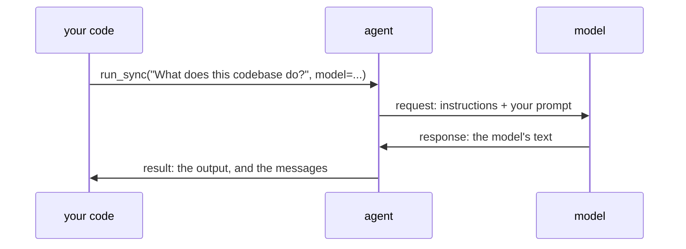

# An agent, and a model you can script

## Welcome

Welcome back. In setup you installed Pydantic AI and ran a five-line
agent to prove it worked. This lesson slows down and looks at what that
agent actually did.

It's about three things: the **model**, the **agent**, and the
**messages** they send each other. You build the project's agent, print
every message of a run, and then write a model of your own, a Python
function, so you decide what it says.

By the end, you'll be able to:

1. **Say what the model is and what the agent is**, and why this project
   gives the agent its model on each run.
2. **Print the messages of a run**, and find your prompt, the
   instructions and the reply in them.
3. **Stand in for the model with `FunctionModel`**, and say when
   `TestModel` is enough.

About 15 minutes.

## Concepts

### The model

The model is the part that answers. You send it text, and it sends text
back. Usually it's a large language model at a provider, such as
Anthropic or OpenAI, and every request goes over the network and is
billed.

It doesn't have to be. Pydantic AI also ships two models that run inside
your own program. They need no API key and cost nothing:

- **`TestModel`**, which you used in setup. It always gives the same kind
  of reply. With no tools, that's `success (no tool calls)`.
- **`FunctionModel`**, which calls a Python function you write. Whatever
  your function returns is the model's answer.

`TestModel` tells you the agent runs. `FunctionModel` lets you choose the
exact reply, so you can test what your code does with it. This lesson
uses both.

### The agent

The agent is the part of your program that talks to the model. You
configure it. Today it gets a name and **instructions**: text the agent
sends with every request, to tell the model what its job is. (Lesson
01-05 compares instructions with a system prompt.) Later lessons give it
tools.

Creating an agent sends nothing. Nothing happens until you run it. A
**run** is one use of the agent: you give it a prompt, it asks the model,
and it hands you the answer.

The agent and the model are separate objects. In this project the agent
has no model of its own; each run says which model to use. So the same
agent runs on `TestModel` today and on a real model later, without a
change to the agent.

### They talk in messages

The agent and the model communicate by passing messages. The agent sends
a **request**, and the model sends back a **response**. A run keeps every
message, in order, and `result.all_messages()` gives them to you.

Each message is made of **parts**. In a request, your prompt is a
`user-prompt` part. In a response, the model's reply is a `text` part.
Later lessons add other kinds, such as a tool call.

The answer your code gets back, `result.output`, is taken from the last
response.

The smallest run is one request and one response, and that's the run in
this lesson:



One thing to guess before step 2: the agent sends its instructions with
every request. Are they one of the request's parts?

## What you'll build

You add the agent to the project's package, and two scripts that run it.
One prints every message of a run on `TestModel`. The other runs the
agent on a model you write.

```text
pydantic-tutor/
├── hello_agent.py          from setup, unchanged
├── scripts/
│   ├── inspect_run.py      new: runs the agent on TestModel and prints its messages
│   └── scripted_run.py     new: runs the agent on a function you write
└── src/
    └── pydantic_tutor/
        ├── __init__.py     from setup, unchanged
        └── agent.py        new: the project's agent
```

And the steps, in order:

1. **Create the agent**, with a name and instructions, and no model.
2. **Read a run**: run it on `TestModel` and print every message.
3. **Write the model**: a function that answers from what it's sent.

Each step ends with a **Check**. If it doesn't show what it says, stop
there: the next step builds on it.

## Before you start

Carry on in your `pydantic-tutor` project from setup.

> [!TIP]
> **Check:** from the project folder, run:
>
> ```bash
> uv run hello_agent.py
> ```
>
> You should see the banner, then the agent's answer on the last line. The
> banner's layout depends on how wide your terminal is; check the first
> line's versions and the last line:
>
> ```text
>                  pydantic-ai v2.56.0 • pydantic-ai-harness v0.56.0 • Python 3.14.8
>       / \
>      /   \       agent: agent • model: test:test • tools: 0 • capabilities: 0
>    /___.___\
>   /    |    \    observability: off — see every model and tool call live, with cost
> /      |      \    set it up free with Logfire and a GitHub login: https://pydantic.dev/ai-setup.md
> `---.._|_..---'    or use any OpenTelemetry backend: https://pydantic.dev/docs/ai/logfire/#otel
>
>                  goes away once observability is on — or PYDANTIC_AI_NO_BANNER=1
> success (no tool calls)
> ```

> [!WARNING]
> **Joining here, or has your project gone wrong?** If your project works,
> skip this. To refresh a broken project, delete its `pydantic-tutor` folder
> first: you lose your work and anything else in it, including local
> credentials. Then, from the folder that should hold the project:
>
> ```bash
> git clone --branch 01-01-setup/end --single-branch https://github.com/chrislomeli/pydanticai-tutorial-student.git pydantic-tutor
> cd pydantic-tutor
> uv sync
> ```
>
> The copy also has a `tests/` folder, our own checks for each lesson. You
> don't need it. Then run the check above.

## Step 1: Create the agent

> **Goal:** build the project's agent, with a name and instructions, and
> no model.

You put the agent in the project's package, where the scripts can import
it.

We'll give the agent a name and instructions, but won't ask it anything
yet. **Notice there's no `model=` argument:** each run will say which
model to use.

Create `agent.py` in `src/pydantic_tutor/`, next to `__init__.py`:

`src/pydantic_tutor/agent.py`:

```python
from pydantic_ai import Agent

# No model here: each run says which model to use, so the same agent runs on
# a test model now and a real one later.
agent = Agent(
    name="assistant",
    instructions="You answer questions about a Python codebase. Answer briefly.",
)
```

> [!TIP]
> **Check:** import it, and print its name and its model:
>
> ```bash
> uv run python -c "from pydantic_tutor.agent import agent; print(agent.name, agent.model)"
> ```
>
> You should see:
>
> ```text
> assistant None
> ```

**What it means**

`None` means the agent has no model. That's the choice from Concepts:
the model comes with each run.

The `name` shows in the banner when the agent runs. In setup's
`hello_agent.py` you didn't set one, so Pydantic AI used the variable's
name, `agent`.

What if neither the agent nor the run names a model? Guess the error
before you read on. The run stops before it sends anything, and the
error ends:

```text
pydantic_ai.exceptions.UserError: `model` must either be set on the agent or included when calling it.
```

## Step 2: Read a run

> **Goal:** run the agent on `TestModel`, and read the messages it sent
> and received: their kind, their parts, and where the instructions are.

You run the agent once and print every message, to see the request and
the response for yourself.

Instead of looking only at `result.output`, let's inspect the messages
that produced it. **Watch the distinction between a request and a
response:** the script prints what the agent sent to the model and what
the model sent back.

Create a folder, `scripts/`, in the project folder, and `inspect_run.py`
in it:

`scripts/inspect_run.py`:

```python
"""Run the agent once on TestModel and print every message it sent and received."""

from pydantic_ai.messages import ModelRequest
from pydantic_ai.models.test import TestModel

from pydantic_tutor.agent import agent

# TestModel answers at once, inside this program: no key, no cost.
result = agent.run_sync(user_prompt="What does this codebase do?", model=TestModel())

# Every message of the run, in order: requests to the model, responses back.
for message in result.all_messages():
    # The message's kind, and the kind of each of its parts.
    print(message.kind, [part.part_kind for part in message.parts])
    if isinstance(message, ModelRequest):
        # The instructions travel on the request itself, not as a part.
        print("  instructions:", message.instructions)

print("output:", result.output)
```

Run it:

```bash
uv run scripts/inspect_run.py
```

> [!TIP]
> **Check:** you should see the banner, with the agent's name and the
> model, then four lines. The banner's layout depends on how wide your
> terminal is:
>
> ```text
>                  pydantic-ai v2.56.0 • pydantic-ai-harness v0.56.0 • Python 3.14.8
>       / \
>      /   \       agent: assistant • model: test:test • tools: 0 • capabilities: 0
>    /___.___\
>   /    |    \    observability: off — see every model and tool call live, with cost
> /      |      \    set it up free with Logfire and a GitHub login: https://pydantic.dev/ai-setup.md
> `---.._|_..---'    or use any OpenTelemetry backend: https://pydantic.dev/docs/ai/logfire/#otel
>
>                  goes away once observability is on — or PYDANTIC_AI_NO_BANNER=1
> request ['user-prompt']
>   instructions: You answer questions about a Python codebase. Answer briefly.
> response ['text']
> output: success (no tool calls)
> ```
>
> From here on, the outputs are shown without the banner.

**What it means**

The run made one request and got one response:

- The request has one part, `user-prompt`: your question.
- The response has one part, `text`: the model's reply.
- `output` is that same text, taken from the response.

Now your guess from Concepts. The instructions are not one of the
request's parts. They travel on the request itself, as
`message.instructions`, next to the parts.

The reply is what `TestModel` always says. It shows the agent works, but
not what your code does with a real answer. For that you need to choose
the answer, which is the next step.

## Step 3: Write the model

> **Goal:** replace the model with a function you write, which answers
> from what it's sent.

You write the model yourself. `FunctionModel` calls your function once
for each request, passes it the messages so far and the instructions,
and uses what it returns as the model's reply.

This time you'll provide the model's reply yourself. The `reply`
function receives a model request and returns a model response.
**Watch where the reply is made:** the `FunctionModel` calls your Python
function instead of a remote LLM. The agent still handles the run.

Create `scripted_run.py` in `scripts/`:

`scripts/scripted_run.py`:

```python
"""Run the agent on a model you write: a function that answers from the request."""

from pydantic_ai.messages import ModelMessage, ModelResponse, TextPart, UserPromptPart
from pydantic_ai.models.function import AgentInfo, FunctionModel

from pydantic_tutor.agent import agent


def reply(messages: list[ModelMessage], info: AgentInfo) -> ModelResponse:
    """Stand in for the model: answer from what the model is sent.

    FunctionModel calls this once for each request the agent makes, with
    every message of the run so far, and `info`, which carries what is sent
    beside the messages, such as the agent's instructions. What it returns
    is what the model said.
    """
    request = messages[-1]  # the latest message: the request to answer
    # A request is made of parts; the user's prompt is one of them.
    for part in request.parts:
        if isinstance(part, UserPromptPart):
            text = f"You asked {part.content!r}, and my instructions say: {info.instructions}"
            # One text part: the model's whole answer, which becomes result.output.
            return ModelResponse(parts=[TextPart(content=text)])
    # This agent has no tools, so every request carries the prompt. With
    # tools, a request can carry only a tool's return, and this function
    # would have to answer that too.
    raise ValueError("the request has no user prompt")


# The model is given for this run only; the agent itself has none (agent.py).
result = agent.run_sync(
    user_prompt="What does this codebase do?", model=FunctionModel(function=reply)
)
print(result.output)
```

Run it:

```bash
uv run scripts/scripted_run.py
```

> [!TIP]
> **Check:** after the banner (its model line now names your function),
> you should see exactly the sentence your function built, with your
> prompt in it:
>
> ```text
> You asked 'What does this codebase do?', and my instructions say: You answer questions about a Python codebase. Answer briefly.
> ```

**What it means**

Your prompt and your instructions are both in the answer, so your
function wrote it, not a canned reply.

Your function got the same things step 2 printed:

- `messages` is every message so far. Here that's one request.
  `messages[-1]` is the request to answer, and its `UserPromptPart`
  holds your prompt.
- `info.instructions` is the agent's instructions. They arrive beside
  the messages, not inside them, as step 2 showed.

It returns a `ModelResponse` with one `TextPart`, and that becomes
`result.output`. If the request had no prompt, the function raises an
error instead of inventing an answer.

## What you can now do

You know the three pieces every Pydantic AI program is built from:

- **The model** answers. It can be a real LLM or a stand-in: `TestModel`
  to check the agent runs, `FunctionModel` to choose the reply.
- **The agent** is your program's side: a name, instructions, and later
  tools. In this project it gets its model on each run.
- **Messages** carry everything between them: requests and responses,
  each made of parts. The instructions travel on each request, beside
  the parts.

Writing the model yourself is what lets every later lesson be checked
without an API key.

## Next

Right now the agent can only answer from its instructions. In the next
lesson you give it tools, and see the model ask to call one, and the
tool's return going back.

---

*Tested with `pydantic-ai` 2.56.0 and `pydantic-ai-harness` 0.56.0.*
