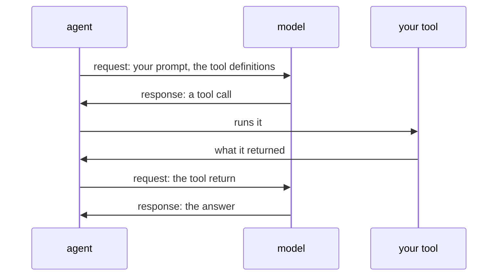

# Tools, and the loop that calls them

## Welcome

Welcome back. In the last lesson you built an agent and read the messages
of a run: one request, one response, and the model's text.

This lesson follows one question: **what actually happens when a model
asks to use a tool?** You'll see what the model is told about your
functions, how the agent runs one on the model's behalf, and what happens
when the model supplies an argument that needs correcting.

By the end, you'll be able to:

1. **Say what a tool is, and what the model is told about it.**
2. **Trace the loop a tool call makes**, and count its requests.
3. **Check the arguments the model wrote**, and tell it what to fix with
   `ModelRetry`.

About 15 minutes.

## Concepts

### What a tool is

A tool is a Python function you give the agent. The model can't run it.
The model only reads messages and writes messages. When it needs a
tool, it writes a **tool call** in its response: the tool's name, and the
arguments to call it with. The agent runs your function and sends back
what it returned, the **tool return**.

So the model needs to know which tools exist and how to call them. With
every request, the agent sends a **tool definition** for each tool, built
from your function:

| From your function                    | What the model receives        |
|---------------------------------------|--------------------------------|
| The function's name                   | The tool's name                |
| The docstring's description           | The tool's description         |
| Parameter names and types             | A JSON schema of the arguments |
| Parameter descriptions, under `Args:` | Each argument's description    |
| The function's body                   | Nothing                        |

The tool definition doesn't include your function's Python body. The
docstring is the tool's manual: the clearer it is, the better the model
can tell when to use the tool and what to pass.

### A tool call makes a loop

A run with a tool call takes more than one request:

1. The agent sends your prompt and the tool definitions.
2. The model's response is a tool call.
3. The agent runs the tool, and sends the tool return in a new request.
4. The model's response is the answer.



That's two requests instead of one. Each response that holds a tool call
adds a request, and with a real model every request is billed.

### The model writes the arguments

The model decides when to call a tool and what arguments to send. Your
program decides which tools exist and what they do with those arguments.
So a tool treats its arguments like anything a stranger types into a
form: it checks them before using them.

Pydantic AI checks the types for you. A number where the schema says
string never reaches your function. But a string of the right type can
still be wrong, such as the name of a product that doesn't exist. That
check is your tool's.

When the value is wrong, the tool raises **`ModelRetry`** with a message
saying what was wrong and what to do instead. The run doesn't stop: the
agent sends the message back to the model, which can try again. Each
tool gets one retry by default. If the model gets it wrong a second time,
the run fails.

## What you'll build

A small agent with two tools over a price list, and two scripts that run
it on stand-in models we give you, in `given/`. The prices sit in the same file as the tools,
because this lesson is about the tools, not where data comes from.

```text
pydantic-tutor/
├── scripts/
│   ├── show_tools.py       new: prints what the model is told about each tool
│   └── tool_loop.py        new: a model that calls a tool, gets it wrong, then answers
└── src/
    └── pydantic_tutor/
        ├── given/
        │   └── tool_models.py  given: the stand-in models
        └── prices.py       new: the price agent and its two tools
```

And the steps, in order:

1. **Write two tools**, and call them yourself.
2. **Print what the model is told** about them.
3. **Watch the loop**, with a model that gets the name wrong first.

Each step ends with a **Check**. If it doesn't show what it says, stop
there: the next step builds on it.

## Before you start

Carry on in your `pydantic-tutor` project from the last lesson. This lesson hands you
some code you run but don't write: stand-in models, in `src/pydantic_tutor/given/`.
From the project folder, fetch them:

```bash
uv run https://raw.githubusercontent.com/chrislomeli/pydanticai-tutorial-student/main/starter/get_starter.py tool-models
```

> [!TIP]
> **Check:** from the project folder, run:
>
> ```bash
> uv run hello_agent.py
> ```
>
> After the banner, the last line should be:
>
> ```text
> success (no tool calls)
> ```

> [!WARNING]
> **Joining here, or has your project gone wrong?** If your project works,
> skip this. To refresh a broken project, delete its `pydantic-tutor` folder
> first: you lose your work and anything else in it, including local
> credentials. Then, from the folder that should hold the project:
>
> ```bash
> git clone --branch 01-02-agent/end --single-branch https://github.com/chrislomeli/pydanticai-tutorial-student.git pydantic-tutor
> cd pydantic-tutor
> uv sync
> ```
>
> The copy also has a `tests/` folder, our own checks for each lesson. You
> don't need it. Then run the check above.

## Step 1: Write two tools

> **Goal:** two plain functions the model will be able to ask for.

You write the tools and call them yourself, before any model is
involved. The first function provides a list of products; the second
looks up one price. **Pay attention to their docstrings:** those are
part of what the model will later see when the functions become tools.

Create `src/pydantic_tutor/prices.py`:

```python
"""A small agent with two tools: a price list it can read for the model.

The prices live in this file, to keep the example about its tools rather
than where data comes from.
"""

from pydantic_ai import Agent, ModelRetry

# Whole cents, so no price is ever rounded.
PRICES_IN_CENTS = {"apple": 50, "bread": 225, "coffee": 700}


def list_products() -> list[str]:
    """List the products that have a price."""
    return sorted(PRICES_IN_CENTS)


def price_of(*, product: str) -> int:
    """Look up the price of one product, in cents.

    Args:
        product: The product's name, as `list_products` gives it.
    """
    # The model wrote `product`: check it before using it.
    if product not in PRICES_IN_CENTS:
        raise ModelRetry(
            message=f"There is no product {product!r}. Call list_products to see them."
        )
    return PRICES_IN_CENTS[product]


# No model here: each run says which model to use.
price_agent = Agent(
    name="prices",
    instructions="You answer questions about prices. Answer briefly.",
    tools=[list_products, price_of],
)
```

> [!TIP]
> **Check:** call both tools yourself:
>
> ```bash
> uv run python -c "from pydantic_tutor.prices import list_products, price_of; print(list_products()); print(price_of(product='coffee'))"
> ```
>
> You should see:
>
> ```text
> ['apple', 'bread', 'coffee']
> 700
> ```
>
> Now ask for a product that doesn't exist:
>
> ```bash
> uv run python -c "from pydantic_tutor.prices import price_of; price_of(product='apples')"
> ```
>
> The last line of the error is your tool's message:
>
> ```text
> pydantic_ai.exceptions.ModelRetry: There is no product 'apples'. Call list_products to see them.
> ```

**What it means**

The tools are ordinary functions. `tools=[list_products, price_of]` is
all it takes to give them to the agent.

`ModelRetry` is the only Pydantic AI name the tools use. Called directly,
as here, it's an ordinary exception. Inside a run, the agent catches it
and sends its message to the model, as step 3 shows.

The message says what was wrong and what to do: call `list_products`.
That's the model's only help, so make it specific.

## Step 2: Print what the model is told

> **Goal:** see the tool definitions the model receives.

The model for this step is given: `prints_tool_definitions()` is a
`FunctionModel`, like the one you wrote in the last lesson. It prints the
tool definitions it is sent, then answers "Done." so the run can finish.

Here we aren't asking the model to call a tool yet. We're using the
given `FunctionModel` to **inspect the definitions** the agent sends:
the names, descriptions and arguments—not the Python function bodies.

Create `scripts/show_tools.py`:

```python
"""Print what the model is told about the price agent's tools."""

from pydantic_tutor.given.tool_models import prints_tool_definitions
from pydantic_tutor.prices import price_agent

price_agent.run_sync(
    user_prompt="How much is an apple?", model=prints_tool_definitions()
)
```

```bash
uv run scripts/show_tools.py
```

> [!TIP]
> **Check:** the banner now says `tools: 2`. After it:
>
> ```text
> list_products
>   description: List the products that have a price.
>   parameters: {
>   "additionalProperties": false,
>   "properties": {},
>   "type": "object"
> }
> price_of
>   description: Look up the price of one product, in cents.
>   parameters: {
>   "additionalProperties": false,
>   "properties": {
>     "product": {
>       "description": "The product's name, as `list_products` gives it.",
>       "type": "string"
>     }
>   },
>   "required": [
>     "product"
>   ],
>   "type": "object"
> }
> ```

**What it means**

This is the whole of what the model knows about your tools. Match it to
`prices.py`:

- The name is the function's name.
- The description is the docstring's first line.
- The `Args:` line for `product` became that argument's description in
  the schema. `product` is `"required"` because it has no default.

`PRICES_IN_CENTS` and the `if` that checks the name aren't there. The
model knows how to ask for `price_of`, not how it works.

## Step 3: Watch the loop

> **Goal:** run a model that calls a tool, gets the name wrong, tries
> again, and answers.

The model in this step is given too, `asks_with_a_wrong_name()`. It
follows a fixed script:

1. On the first request: call `price_of` with `product="apples"`, a name
   that doesn't exist.
2. If the latest request holds a retry: call it again, with `"apple"`.
3. If it holds the tool return: answer with the price.

A real model decides for itself. The script lets you see each message.

Before you run it, guess: how many requests will the run make? Write
your guess down.

Now we'll watch a whole tool-call loop. The given model requests a tool,
the agent runs it, and the model responds again. **Follow the message
order in the printed output:** it makes the extra model request visible.

Create `scripts/tool_loop.py`:

```python
"""Run the price agent on a model that calls a tool, gets it wrong, then answers."""

from pydantic_ai.messages import RetryPromptPart

from pydantic_tutor.given.tool_models import asks_with_a_wrong_name
from pydantic_tutor.prices import price_agent

result = price_agent.run_sync(
    user_prompt="How much is an apple?", model=asks_with_a_wrong_name()
)

for message in result.all_messages():
    print(message.kind, [part.part_kind for part in message.parts])
    for part in message.parts:
        if isinstance(part, RetryPromptPart):
            print("  told the model:", part.content)
print("output:", result.output)
print("requests:", result.usage.requests)
```

```bash
uv run scripts/tool_loop.py
```

> [!TIP]
> **Check:** after the banner, six messages, your tool's message, the
> answer, and the count:
>
> ```text
> request ['user-prompt']
> response ['tool-call']
> request ['retry-prompt']
>   told the model: There is no product 'apples'. Call list_products to see them.
> response ['tool-call']
> request ['tool-return']
> response ['text']
> output: An apple costs 50 cents.
> requests: 3
> ```

**What it means**

Three requests. Was that your guess?

- **Request 1** carries your question. The model asks for `price_of`
  with `"apples"`.
- **Request 2** carries your tool's `ModelRetry` message, as a
  `retry-prompt` part. The model asks again, with `"apple"`.
- **Request 3** carries the tool return, `50`. The model answers.

Your tool ran twice, in your program, between the requests. The model
never ran it.

Without the wrong name, the run would have made two requests, as in
Concepts. The retry cost one more. With a real model that's one more
billed request, so a clear tool message is worth writing.

The model gets your `ModelRetry` message with one line from Pydantic AI
after it, asking it to fix the error and try again.

## What you can now do

- **A tool** is a Python function the agent runs for the model. The
  model sees only its definition: the name, the docstring and a schema
  of the arguments.
- **A tool call makes a loop.** The model asks, the agent runs the tool,
  and the tool return goes back in the next request. Each response that
  holds a tool call adds a request.
- **The model writes the arguments**, so your tool checks them. When one
  is wrong, `ModelRetry` tells the model what to fix, and the run goes
  on.

## Next

So far every value a tool uses is fixed in its file. In the next lesson
each run hands the agent values of its own, its dependencies, which
your tools and instructions can read and the model never sees.

---

*Tested with `pydantic-ai` 2.56.0 and `pydantic-ai-harness` 0.56.0.*
