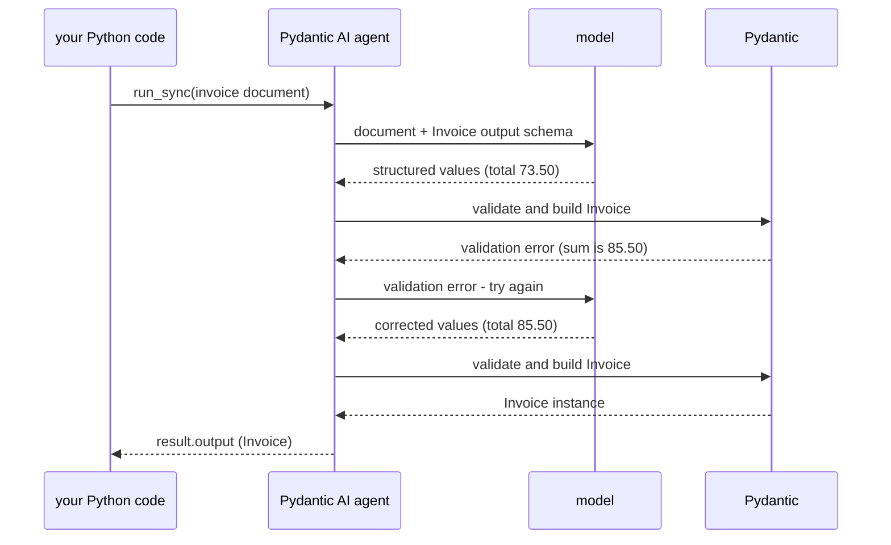

# Structured output: a typed answer

## Welcome

Welcome back. In the last lesson each run handed the agent a shop. The
answer was still a text sentence.

This lesson is about **structured output**: asking a model to return
data in a known shape, so your program receives an object it can use.
We'll extract an `Invoice` from a document, then catch an incorrect total.

By the end, you'll be able to:

1. **Explain the division of work** between the model, Pydantic AI and
   Pydantic when an agent returns a typed answer.
2. **Get an `Invoice` from an agent** without expecting the model to make
   a Python object.
3. **Add a validation rule** and understand what it can—and cannot—check.

About 15 minutes.

## Concepts

### What changes when you ask for a type?

So far, your agents have answered in words: `result.output` was a
string. But imagine you're writing a program that needs an invoice
number, a date, and a total. You don't want to search a paragraph for
those values. You want an `Invoice` object with named fields.

You can tell Pydantic AI what kind of answer your program needs:

```python
extractor = Agent(output_type=Invoice)
```

When the run succeeds, `result.output` is an instance of `Invoice`.
If the model cannot supply a valid answer within the allowed attempts,
the run fails instead.

**But the model doesn't create that Python object.** So who does?

### Who does what?

There are four parts to the exchange:

1. **You define the answer.** You write a Pydantic `Invoice` class
   with fields such as `number: str` and `total: Decimal`, then pass
   it as `output_type`.
2. **Pydantic AI tells the model what to return.** From your class it
   prepares a schema describing the fields. With the default
   tool-based structured-output mode used here, it offers the model a
   special *output tool* whose arguments must follow that schema.
   This isn't a Python function you'll write or run.
3. **The model proposes the field values.** It reads the document and
   responds with a structured output-tool call: data containing an
   invoice number, dates, line items and a total. These are **not**
   Python `Invoice` or `Decimal` instances.
4. **Pydantic AI and Pydantic process the response.** Pydantic AI
   receives the model's proposed data and passes it to Pydantic for
   validation and construction. If it passes, your program receives
   `result.output` as an `Invoice`. If not, Pydantic AI can send the
   validation error back to the model and request another attempt.

Here's the important part of step 3. The model's response contains
structured values *conceptually like* these output-tool arguments:

```json
{
  "number": "INV-0042",
  "issued": "2026-09-30",
  "supplier": "Acme Paper Co.",
  "currency": "GBP",
  "lines": [
    {"description": "A4 paper, box of 5", "quantity": 3, "unit_price": "24.50"},
    {"description": "Stapler", "quantity": 1, "unit_price": "12.00"}
  ],
  "total": "73.50"
}
```

The model supplies these values; it doesn't execute Python or call
`Invoice(...)`. Pydantic interprets them according to your class,
including converting the date and decimal strings into Python values.

Other Pydantic AI output modes can ask for JSON text instead of an
output-tool call. The format of the model response changes; the division
of work does not.

### What validation can—and cannot—tell you

Pydantic first checks that the supplied data fits your model: required
fields exist and the values can be interpreted as the declared types.
But a well-formed `Invoice` isn't necessarily an accurate extraction.

The document below says the total is 85.50. The model might send 73.50
instead. That's still a perfectly valid `Decimal`, so the type check
alone won't catch the mistake.

We can add another rule to the `Invoice` class: **the total must equal
the sum of each line's quantity times its unit price**. Pydantic then
checks that rule too. If it fails, Pydantic AI sends the error to the
model and asks for another attempt, once by default.



**A rule checks only what it knows how to check.** If the model copies
the wrong quantity *and* returns a matching total, the arithmetic rule
can pass even though the extraction is wrong. Validation enforces types
and rules you define; it doesn't prove every value matches the source.

## What you'll build

An agent called `extractor` whose answer is an `Invoice`, and a script
that runs it on one document with a stand-in model we give you. That
model gets the total wrong the first time, on purpose.

```text
pydantic-tutor/
├── pyproject.toml               changed: pydantic, pinned
├── scripts/
│   └── extract_invoice.py       new: the extractor on one invoice
└── src/
    └── pydantic_tutor/
        ├── given/
        │   └── invoice_model.py given: the invoice, and the stand-in model
        └── invoices.py          new: Invoice, and the extractor agent
```

And the steps, in order:

1. **Describe the answer**: write `Invoice` and the extractor, and run
   it.
2. **Check the answer**: give `Invoice` a rule, and see a wrong answer
   sent back.

Each step ends with a **Check**. If it doesn't show what it says, stop
there: the next step builds on it.

## Before you start

Carry on in your `pydantic-tutor` project from the last lesson. This lesson hands you one
more stand-in model, with the invoice it reads. From the project folder, fetch it:

```bash
uv run https://raw.githubusercontent.com/chrislomeli/pydanticai-tutorial-student/main/starter/get_starter.py invoice-model
```

> [!TIP]
> **Check:** from the project folder, run:
>
> ```bash
> uv run hello_agent.py
> ```
>
> After the banner, the last line should be:
>
> ```text
> success (no tool calls)
> ```

> [!WARNING]
> **Joining here, or has your project gone wrong?** If your project works,
> skip this. To refresh a broken project, delete its `pydantic-tutor` folder
> first: you lose your work and anything else in it, including local
> credentials. Then, from the folder that should hold the project:
>
> ```bash
> git clone --branch 01-05-instructions/end --single-branch https://github.com/chrislomeli/pydanticai-tutorial-student.git pydantic-tutor
> cd pydantic-tutor
> uv sync
> ```
>
> The copy also has a `tests/` folder, our own checks for each lesson. You
> don't need it. Then run the check above.

## Step 1: Describe the answer

> **Goal:** write the answer as a type, `Invoice`, and an agent whose
> answer is one.

Here's the invoice the agent reads:

```text
ACME PAPER CO.
12 Mill Lane, Leeds LS1 4AB

INVOICE                                  No. INV-0042
Date: 30 September 2026
Bill to: Harbour Books Ltd, 4 Harbour Street, Hull HU1 2AA

Description                     Qty    Unit price      Amount
A4 paper, box of 5                3         24.50       73.50
Stapler                           1         12.00       12.00

Total due (GBP)                                         85.50

Payment within 30 days. Thank you for your business.
```

Add up the total yourself: three boxes of paper at 24.50, plus one
stapler at 12.00. Keep that number in mind.

We're going to describe the answer before asking a model to extract
anything. `LineItem` describes one product on the invoice; `Invoice`
brings those lines together with the invoice number, date, supplier and
total. **Look at the agent declaration at the bottom:**
`output_type=Invoice` is the line that tells Pydantic AI what kind of
answer our program expects.

We're about to import `pydantic` directly, so add it to our project's
dependencies, pinned to the version this lesson was tested with.
`pydantic-ai` already installed a version of it; if that one is newer,
`uv` moves it to the pin:

```bash
uv add "pydantic==2.14.1"
```

Create `src/pydantic_tutor/invoices.py`:

```python
"""An invoice, as a type, and an agent that reads one out of a document."""

from datetime import date
from decimal import Decimal

from pydantic import BaseModel, Field
from pydantic_ai import Agent


class LineItem(BaseModel):
    """One line of an invoice."""

    description: str
    quantity: int
    unit_price: Decimal = Field(description="The price of one, as printed.")


class Invoice(BaseModel):
    """An invoice, as printed on the document."""

    number: str = Field(description="The invoice number, as printed.")
    issued: date = Field(description="The date the invoice was issued.")
    supplier: str = Field(description="Who sent the invoice.")
    currency: str = Field(description="The three-letter currency code, such as GBP.")
    lines: list[LineItem]
    total: Decimal = Field(description="The total due, as printed.")


# No model here: each run says which model to use.
extractor = Agent(
    name="invoice_extractor",
    output_type=Invoice,
    instructions="Extract the invoice from the document you are given. Copy every value as printed.",
)
```

The money fields are `Decimal`, not `float`, because money needs exact
decimals. We've defined the structure of an invoice, but we haven't
written any code to read values out of the document. That is the model's
job; Pydantic AI and Pydantic handle the structured result.

Next, we'll run the extractor on the invoice above. The given `DOCUMENT`
contains its text, and `misreads_the_total()` is a stand-in model that
intentionally copies the first line's amount instead of the invoice total.
**Notice `result.output`:** the script treats it as an `Invoice` and
reads its fields directly. It also prints the number of model requests.

Create `scripts/extract_invoice.py`:

```python
"""Extract an invoice from a text document, on a model that misreads it once."""

from pydantic_tutor.given.invoice_model import DOCUMENT, misreads_the_total
from pydantic_tutor.invoices import extractor

result = extractor.run_sync(user_prompt=DOCUMENT, model=misreads_the_total())
invoice = result.output  # an Invoice, not text
print("number:", invoice.number)
print("issued:", invoice.issued)
print("total:", invoice.total, invoice.currency)
print("requests:", result.usage.requests)
```

```bash
uv run scripts/extract_invoice.py
```

> [!TIP]
> **Check:** after the banner, you should see:
>
> ```text
> number: INV-0042
> issued: 2026-09-30
> total: 73.50 GBP
> requests: 1
> ```

**What it means**

The model returned structured field values, not a Python object.
Pydantic AI handed those values to Pydantic, which built an `Invoice`.
So `invoice.total` is a `Decimal`, and `invoice.issued` is a `date`:
the document says "30 September 2026", and your code gets `2026-09-30`.

Now compare the total with yours. The invoice says 85.50, but this
printed 73.50, the first line's amount. Every field passed the type
checks, so Pydantic accepted the values. The object is valid according
to the rules we've written so far, but its total is wrong.

## Step 2: Check the answer

> **Goal:** give `Invoice` a rule, that its total is the sum of its
> lines, and see the agent send a wrong answer back to the model.

The rule is a Pydantic **model validator**: a method marked
`@model_validator(mode="after")`. It runs after Pydantic has interpreted
the fields and raises `ValueError` if the line totals don't add up.

We're keeping the same `Invoice` and the same extractor. The new part
is `check_total`, a method on `Invoice` marked with `@model_validator`.
**Watch what it compares:** it computes a total from the quantities and
unit prices, then raises `ValueError` if that sum disagrees with the
model's proposed total. We aren't teaching the model arithmetic here;
we're adding a check that runs in Python.

In `src/pydantic_tutor/invoices.py`, import `Self` and `model_validator`,
and add the method to `Invoice`. The whole file is now:

```python
"""An invoice, as a type, and an agent that reads one out of a document."""

from datetime import date
from decimal import Decimal
from typing import Self

from pydantic import BaseModel, Field, model_validator
from pydantic_ai import Agent


class LineItem(BaseModel):
    """One line of an invoice."""

    description: str
    quantity: int
    unit_price: Decimal = Field(description="The price of one, as printed.")


class Invoice(BaseModel):
    """An invoice, as printed on the document."""

    number: str = Field(description="The invoice number, as printed.")
    issued: date = Field(description="The date the invoice was issued.")
    supplier: str = Field(description="Who sent the invoice.")
    currency: str = Field(description="The three-letter currency code, such as GBP.")
    lines: list[LineItem]
    total: Decimal = Field(description="The total due, as printed.")

    @model_validator(mode="after")
    def check_total(self) -> Self:
        """Refuse a total that is not the sum of the lines."""
        expected = sum(
            (line.quantity * line.unit_price for line in self.lines),
            start=Decimal(value=0),
        )
        if self.total != expected:
            raise ValueError(
                f"The total {self.total} is not the sum of the lines, {expected}."
            )
        return self


# No model here: each run says which model to use.
extractor = Agent(
    name="invoice_extractor",
    output_type=Invoice,
    instructions="Extract the invoice from the document you are given. Copy every value as printed.",
)
```

The script from Step 1 hasn't changed. What changes is what happens
to its first proposed result: the validation error sends the model back
for another attempt. Before you run it, guess: how many requests will
the run make this time?

```bash
uv run scripts/extract_invoice.py
```

> [!TIP]
> **Check:** after the banner, you should see what the model was sent
> back, then the corrected invoice:
>
> ````text
> sent back to the model:
> 1 validation error:
> ```json
> [
>   {
>     "type": "value_error",
>     "loc": [],
>     "msg": "Value error, The total 73.50 is not the sum of the lines, 85.50.",
>     "input": {
>       "number": "INV-0042",
>       "issued": "2026-09-30",
>       "supplier": "Acme Paper Co.",
>       "currency": "GBP",
>       "lines": [
>         {
>           "description": "A4 paper, box of 5",
>           "quantity": 3,
>           "unit_price": "24.50"
>         },
>         {
>           "description": "Stapler",
>           "quantity": 1,
>           "unit_price": "12.00"
>         }
>       ],
>       "total": "73.50"
>     }
>   }
> ]
> ```
>
> Fix the errors and try again.
> number: INV-0042
> issued: 2026-09-30
> total: 85.50 GBP
> requests: 2
> ````

**What it means**

Two requests, where step 1 took one. Pydantic ran `check_total` and
rejected the model's first values. Pydantic AI then sent that error back
to the model instead of ending the run. The retry prompt holds:

- the error your `ValueError` raised, in `msg`;
- the model's own answer, in `input`;
- then "Fix the errors and try again."

The second answer passed Pydantic's checks, so the run ended with an
`Invoice` instance.

The rule belongs to `Invoice`, not to the agent. Other Python code that
constructs the same model gets the same validation rule. And notice
what we *haven't* established: a matching total doesn't prove the model
copied the correct quantities, prices or supplier from the document.
This rule catches an arithmetic inconsistency, not every extraction error.

## What you can now do

- **A typed answer has several participants:** you define `Invoice`;
  Pydantic AI tells the model the expected structure; the model returns
  structured values; Pydantic validates them and constructs the Python
  object available in `result.output`.
- **Validation isn't fact-checking:** types and your own validators
  enforce specific rules. They can catch errors such as a mismatched
  total, but they cannot guarantee that every value was copied from the
  document correctly. Pydantic AI can send a validation error back to
  the model for another attempt.

## Next

The extractor answers with an `Invoice`, always. What if someone says
"Hello"? In the next lesson you find out, and meet the trap waiting for
an agent that should sometimes answer in words.

---

*Tested with `pydantic-ai` 2.56.0 and `pydantic-ai-harness` 0.56.0.*
