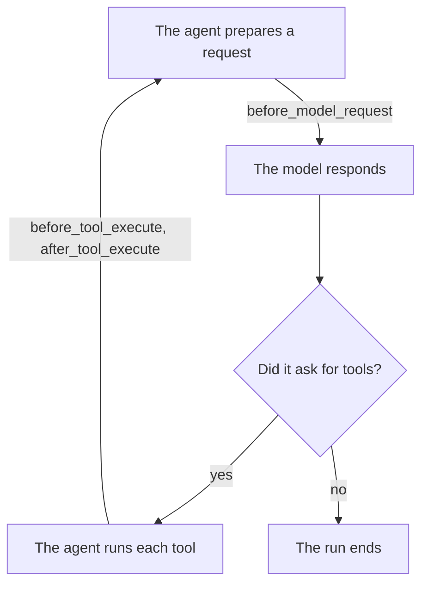

# Agent runs with hooks

## Welcome

This lesson is about **hooks**: functions the agent calls at named points during a run. 
We'll use three hooks to build an **activity log**: it records each model request, each tool the agent is about to execute, and each tool call that finished, so we can read the loop from the log itself. We'll try everything in a separate demo; the next lesson connects the log to our regular chat.

By the end, you'll be able to:

- Say where a hook runs in the agent's loop, and what it's given.
- Write hooks that watch a run without changing it.

About 15 minutes. No API key is needed.

## Concepts

### Hooks run at named points in a run

One user question may require several exchanges with the model. The model can request a tool instead of giving a final answer; the agent executes that tool and sends its result back. This continues until the model answers.

The diagram marks three places where we'll observe that cycle:



Pydantic AI runs the loop and calls our hooks at the points we choose.

You'll see names such as `before_model_request` and `after_tool_execute`. The names identify the hook; the arguments tell our function what happened there. Other hooks can wrap operations or handle errors, but we don't need those to build this log.

### Hooks can observe or change a run

Each hook receives `ctx`, a `RunContext` describing the current run. You met this object when we used dependencies. Here, `ctx.run_step` tells us which model-request step we're observing.

The remaining arguments depend on the hook. A tool hook receives the tool call and its validated arguments. A model-request hook receives a `ModelRequestContext`: the messages and tool definitions about to go to the model.

A hook's return value can change how the run continues. This `before_tool_execute` hook captures the model's request parameters and changes them literally changing how the tool will be called:

### example:
In this case the model asks for a file named `a`, but the hook below changes it to `changed_by_hook.txt`:

```python
async def before_tool_execute(        
    ctx: RunContext[None],
    *,
    call: ToolCallPart,
    tool_def: ToolDefinition,
    args: dict[str, Any],
) -> dict[str, Any]:
    return {**args, "path": "changed_by_hook.txt"}
```

In the log we'll see that even though the model asked for `a` the before_tool_execute changes that to `changed_by_hook.txt` and the tool writes that file:

```text
the model asked for: {'path': 'a', 'content': 'a'}
the model got back: Wrote 1 chars (1 lines) to changed_by_hook.txt. [hash:ca978112ca1b]
```

## What you'll build

- `src/pydantic_tutor/capabilities/activity_log.py`, new: the hook names, the record, three hooks, and a function that builds them into a capability
- `demos/watch_run.py`, new: runs the chat's agent on a stand-in model with the log added, and prints the log

The steps:

1. Write the activity log.
2. Run the agent and read the log.

## Before you start

Carry on in your `pydantic-tutor` project from the last lesson.

> [!TIP]
> **Check:** run `uv run demos/fresh_copy.py`, then `uv run demos/workspace_reach.py`. Its output starts with `tools the model is offered: 14`.

> [!WARNING]
> **Joining here, or has your project gone wrong?** If your project works, skip this. To refresh a broken project, delete its folder first: you lose your work and anything else in it, including your `.env` and its API keys.
>
> ```bash
> git clone --branch 04-01-toolsets/end --single-branch https://github.com/chrislomeli/pydanticai-tutorial-student.git pydantic-tutor
> cd pydantic-tutor
> uv sync
> ```
>
> Then run the check above.

## Step 1: Write the activity log

> **Goal:** write three hooks, and a function that hands them to an agent as one capability.

Each hook records one of the named points in the loop. Together they cover a whole cycle: the request the agent is about to send, the tools it's about to execute, and the tool calls that finished.

Create `src/pydantic_tutor/capabilities/activity_log.py`. This is the whole log: the next lesson connects it to the chat without changing it.

It is the longest block of the lesson, but it does one thing: `build_activity_hooks` makes three hooks — `before_model_request`, `before_tool_execute` and `after_tool_execute` — and each hook writes one `Entry`, a line of the log.

```python
"""Record what the agent does during a run, one JSON line per hook call.

Milestones:
1. HookName: names a hook the log can record.
2. Entry: one line of the log.
3. Hooks: one per name; each writes an entry and returns what it received.
4. Registration: only the chosen names get a hook.

The hooks return their input unchanged, so the log watches and changes nothing.
"""

from enum import StrEnum
from pathlib import Path
from typing import Any

from pydantic import BaseModel
from pydantic_ai import ModelRequestContext, RunContext
from pydantic_ai.capabilities import Hooks
from pydantic_ai.messages import ToolCallPart
from pydantic_ai.tools import ToolDefinition

# The only arguments copied into the log. Named one by one, so a file's
# contents passed to `write_file` never reach it.
LOGGED_ARGUMENTS = ("path", "command")


# 1. HookName
class HookName(StrEnum):
    """The hooks this log can record, named as in `Hooks(...)`."""

    BEFORE_MODEL_REQUEST = "before_model_request"
    BEFORE_TOOL_EXECUTE = "before_tool_execute"
    AFTER_TOOL_EXECUTE = "after_tool_execute"


# 2. Entry
class Entry(BaseModel):
    """One line of the log: names and counts, never contents.

    Fields left as `None` aren't written.
    """

    hook: HookName
    step: int
    tool: str | None = None
    target: str | None = None
    messages: int | None = None
    tools: int | None = None
    result_chars: int | None = None


def build_activity_hooks(
    *, path: Path, hooks: frozenset[HookName] = frozenset(HookName)
) -> Hooks[None]:
    """A capability that logs the chosen hooks to the file at `path`."""

    def write(*, entry: Entry) -> None:
        with path.open(mode="a") as log:
            log.write(entry.model_dump_json(exclude_none=True) + "\n")

    # 3. Hooks
    # `async`, with no `await` inside: when the model asks for several tools
    # at once, these hooks can't write over each other.
    async def before_model_request(
        ctx: RunContext[None], request_context: ModelRequestContext
    ) -> ModelRequestContext:
        write(
            entry=Entry(
                hook=HookName.BEFORE_MODEL_REQUEST,
                step=ctx.run_step,
                messages=len(request_context.messages),
                tools=len(request_context.model_request_parameters.function_tools),
            )
        )
        return request_context

    async def before_tool_execute(
        ctx: RunContext[None],
        *,
        call: ToolCallPart,
        tool_def: ToolDefinition,
        args: dict[str, Any],
    ) -> dict[str, Any]:
        targets = [str(args[name]) for name in LOGGED_ARGUMENTS if name in args]
        write(
            entry=Entry(
                hook=HookName.BEFORE_TOOL_EXECUTE,
                step=ctx.run_step,
                tool=call.tool_name,
                target=targets[0] if targets else None,
            )
        )
        return args

    async def after_tool_execute(
        ctx: RunContext[None],
        *,
        call: ToolCallPart,
        tool_def: ToolDefinition,
        args: dict[str, Any],
        result: object,
    ) -> object:
        write(
            entry=Entry(
                hook=HookName.AFTER_TOOL_EXECUTE,
                step=ctx.run_step,
                tool=call.tool_name,
                result_chars=len(str(result)),
            )
        )
        return result

    # 4. Registration
    return Hooks[None](
        before_model_request=(
            before_model_request if HookName.BEFORE_MODEL_REQUEST in hooks else None
        ),
        before_tool_execute=(
            before_tool_execute if HookName.BEFORE_TOOL_EXECUTE in hooks else None
        ),
        after_tool_execute=(
            after_tool_execute if HookName.AFTER_TOOL_EXECUTE in hooks else None
        ),
    )
```

What's in it:

- `HookName` names the three hooks the log can record, one per point in the loop. A `StrEnum` limits them to these names, so a typo fails at once instead of quietly recording nothing.
- `Entry` is a Pydantic model, because each line leaves the program for a file. It holds names and counts, never contents.
- `LOGGED_ARGUMENTS` names the only arguments we copy. Listing them keeps a file's contents, passed to `write_file`, out of the log.
- `before_model_request` receives a `ModelRequestContext`, and counts the messages and tool definitions about to go to the model.
- `before_tool_execute` receives the tool call and its validated arguments. It records what the agent *attempted*, before we can tell whether the call finished.
- `after_tool_execute` also receives the tool's result, and records that the call finished, with the result's length.
- Each hook ends by returning what it was given: `request_context`, `args`, `result`. That's what makes them watchers.

`build_activity_hooks` returns `Hooks(...)`. Each keyword names a hook, which tells the framework *when* to call the function given to it; a keyword given `None` gets no hook. The `hooks` parameter chooses which hooks are registered. Here we keep its default, all three; in the next lesson a setting chooses.

`Hooks` is a supplied **capability**: a component we attach to an agent to provide behavior. We've already used capabilities such as `FileSystem` and `Shell`.

Run a syntax check before connecting the hooks to the agent and validate that there are no errors:

```bash
uv run python -m py_compile src/pydantic_tutor/capabilities/activity_log.py
```

> [!TIP]
> **Check:** the command finishes without an error.

**What it means**

The file is valid Python. We haven't checked the hooks' behavior yet; the next step runs them with an agent.

## Step 2: Run the agent and read the log

> **Goal:** attach the log for one run and read the loop from its records.

We've built our hooks. Now let's write a small program to see them in action.

We'll use `TestModel` to ask the agent to call two tools. This gives us a predictable run without needing an API key. We'll also attach our new activity log just for this test, leaving the chat application unchanged.

`TestModel` uses `a` for string arguments, so one of its tool calls will create a small file named `a` in our disposable workspace.

Create `demos/watch_run.py`:
```python
"""Run the chat's agent on a stand-in model, and print its activity log.

Needs no API key; run `demos/fresh_copy.py` first. It starts the log again,
so the file holds this run only.
"""

from pydantic_ai.models.test import TestModel

from pydantic_tutor.capabilities.activity_log import build_activity_hooks
from pydantic_tutor.chat.agent import build_chat_agent
from pydantic_tutor.settings import Settings
from tutor_given.paths import project_root

# Beside the workspace copy and not in it, so the file tools can't reach it.
# `work/` is already ignored by git.
LOG_PATH = project_root() / "work" / "activity.jsonl"
LOG_PATH.unlink(missing_ok=True)

chat = build_chat_agent(web_search=False, workspace_root=Settings().workspace_root)
chat.run_sync(
    user_prompt="What does this project do?",
    model=TestModel(call_tools=["list_modules", "write_file"]),
    # Added for this run only: the chat itself doesn't change.
    capabilities=[build_activity_hooks(path=LOG_PATH)],
)
print(LOG_PATH.read_text())
```

`fresh_copy.py` clears anything earlier runs left in the workspace copy:

```bash
uv run demos/fresh_copy.py
uv run demos/watch_run.py
```

> [!TIP]
> **Check:** ignoring any startup banner, you should see:
>
> ```text
> {"hook":"before_model_request","step":1,"messages":1,"tools":14}
> {"hook":"before_tool_execute","step":1,"tool":"list_modules"}
> {"hook":"before_tool_execute","step":1,"tool":"write_file","target":"a"}
> {"hook":"after_tool_execute","step":1,"tool":"list_modules","result_chars":137}
> {"hook":"after_tool_execute","step":1,"tool":"write_file","result_chars":49}
> {"hook":"before_model_request","step":2,"messages":3,"tools":14}
> ```

**What it means**

We can read the run from our own log. The agent prepared a model request, executed the requested tools, and prepared a second model request with their results:

- Both tool calls say `step: 1`. They came from the same model response; a run step is not the same as one tool call.
- `write_file`'s line records its target path, `a`, but not the file's contents.
- Each `before_tool_execute` has a matching `after_tool_execute`, so both tools finished.
- The second request carries three messages: your question, the model's response asking for the tools, and the request carrying the tools' returns.
- All fourteen tool definitions go with every request.
- The run ends after step 2, because the model answered instead of asking for more tools.

The last line is another `before_model_request`, not an `after_tool_execute`: the agent is ready to ask the model again. `TestModel` then gives its final answer, so there is no third request. Each hook passed its received value back unchanged. The agent behaved as it would without our log.

## What you can now do

- **A run is a loop with named hooks.** You can place a function on one, and find the others by their pattern.
- **A hook gets `ctx`, then what its hook passes, and the run carries on with what it returns.** Yours return what they were given, so they only watch.

## Next

We can now observe the agent's loop without changing its behavior. In the next lesson, we'll connect this same activity log to the continuing chat, configure which hooks it records, and inspect a real conversation.

---

*Tested with `pydantic-ai` 2.56.0 and `pydantic-ai-harness` 0.56.0.*
